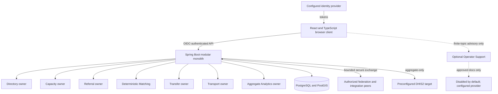
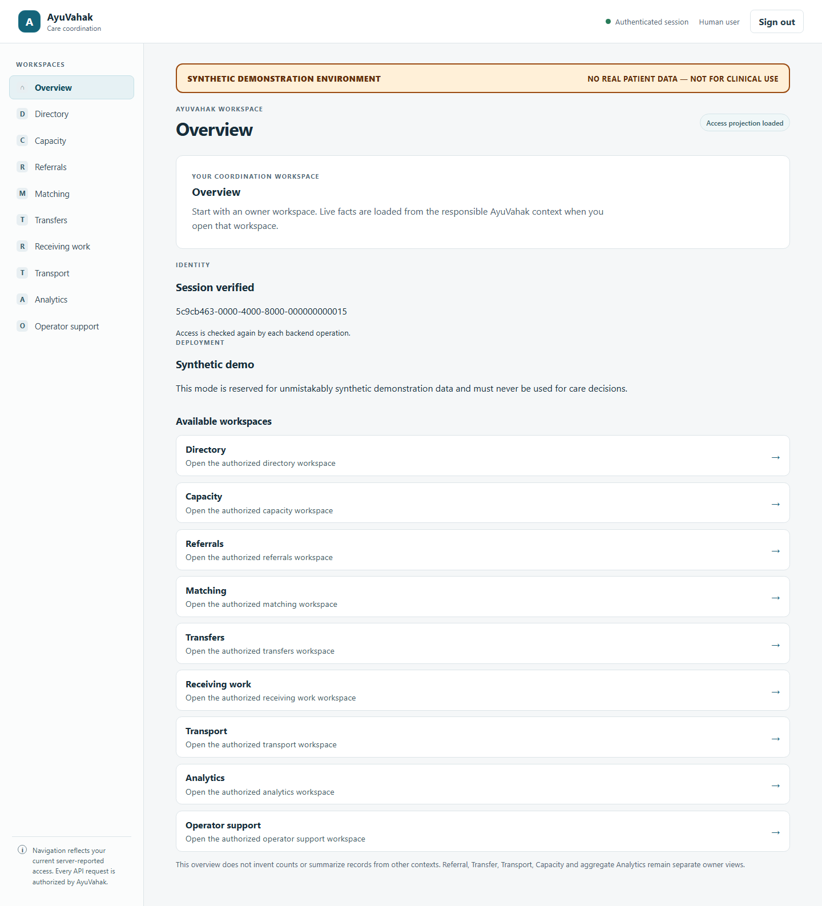
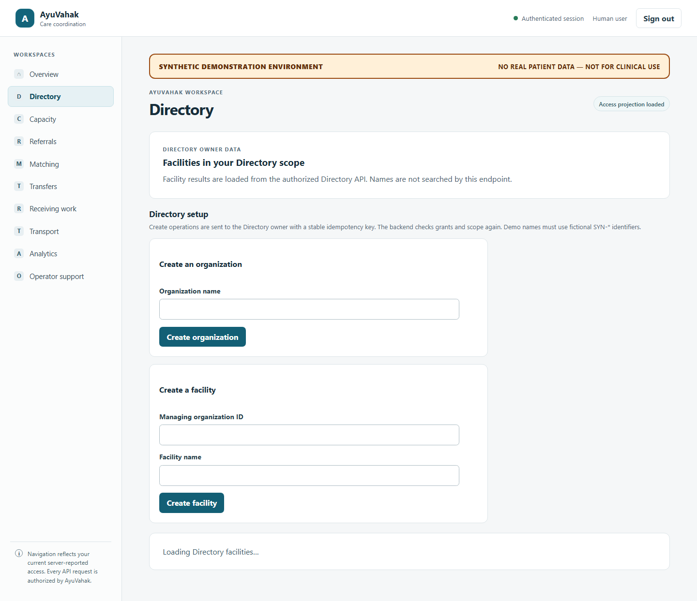
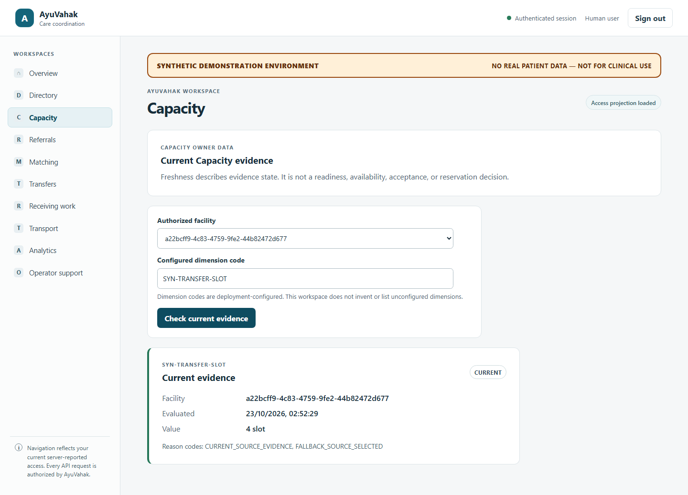
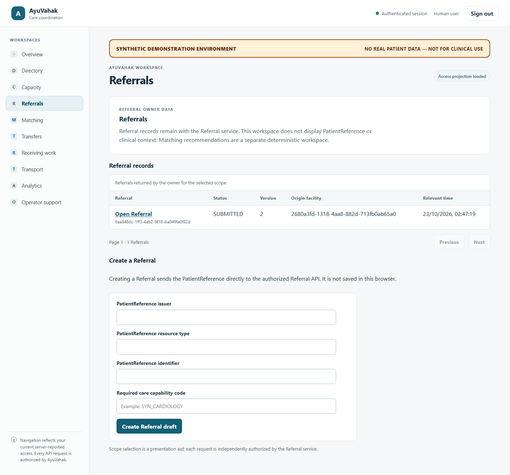
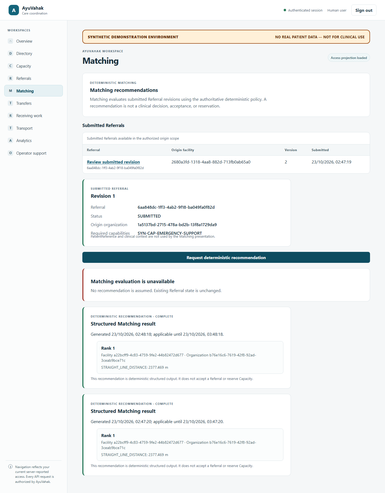
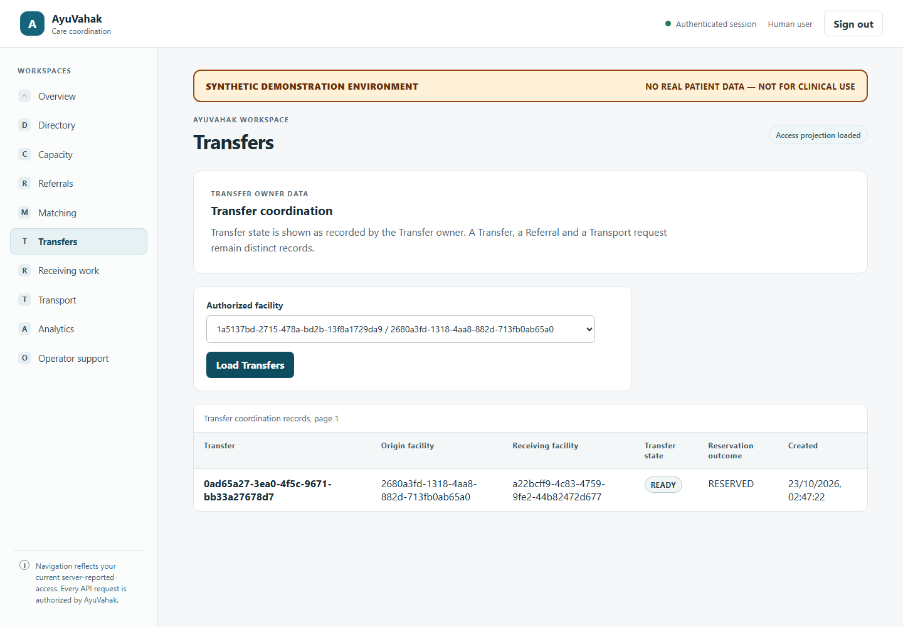
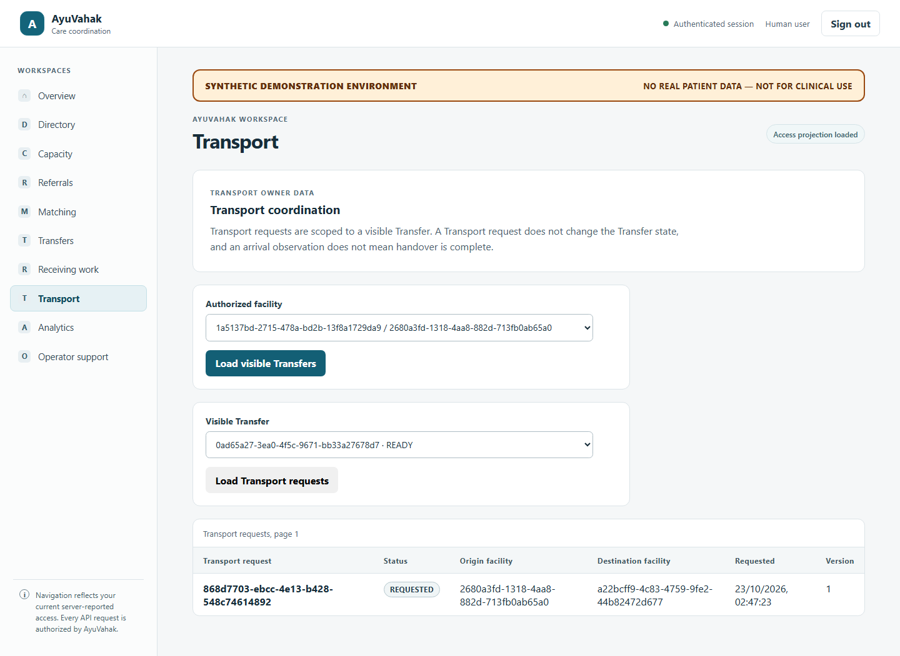
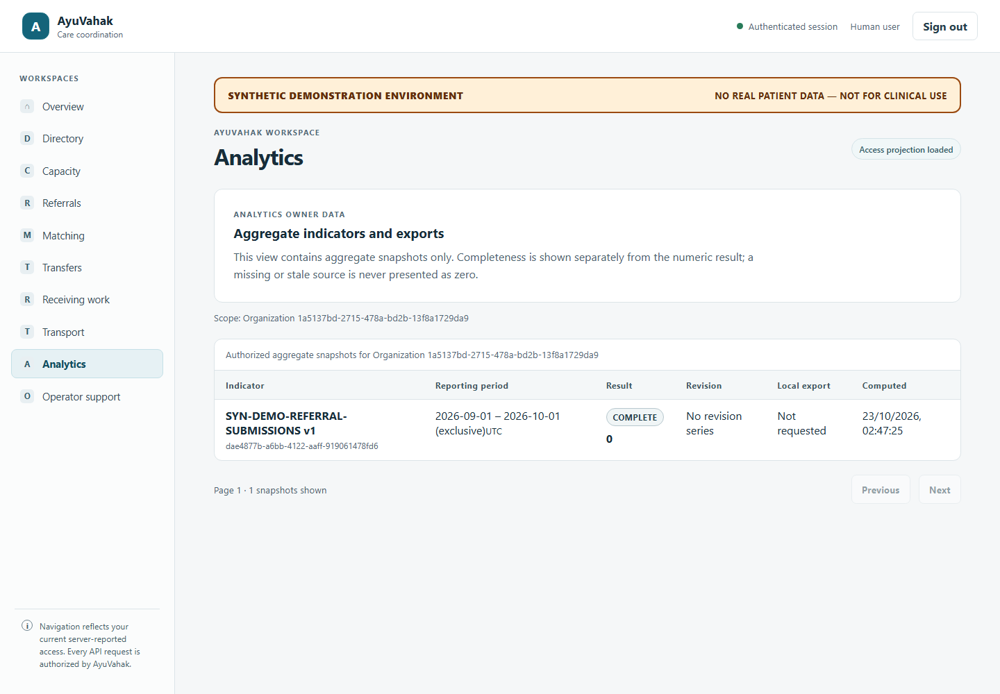
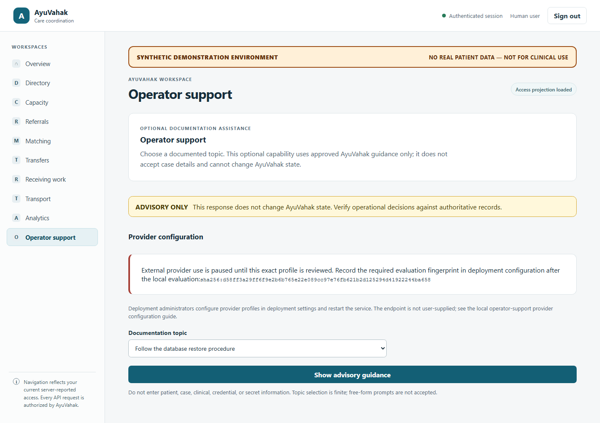

# AyuVahak

**Care coordination for discovering operational capacity and coordinating referrals and inter-facility transfers.**

AyuVahak is a healthcare care-coordination platform. It connects existing organizations and facilities through Directory, Capacity, Referral, deterministic Matching, Transfer, Transport, interoperability, federation and aggregate Analytics workflows. It is not an EHR/EMR, HIE replacement, clinical decision system, dispatch authority or patient portal. Patients are beneficiaries, not direct users.

## Project status

Volumes I–IV and Phase 13 are complete and frozen. The Volume V design is frozen; Phase 14 productization is in progress. There is no final downloadable release yet. Do not treat this working branch or the developer Compose stack as a production deployment.

## Try the local developer installation

Requirements: Docker Desktop (or compatible Docker Engine with Compose v2), PowerShell on Windows, and network access to retrieve pinned build/container dependencies on first use. The Docker build uses pinned Java 25 and Node 24 images; Maven and Node do not need to be installed on the host.

On Windows, run:

```powershell
.\scripts\local\Start-AyuVahak.cmd
```

On first run the launcher asks you to choose **Synthetic Demo** or **Empty** before starting services. You can also choose explicitly with `scripts/local/Start-AyuVahak.ps1 -Mode SYNTHETIC_DEMO` or `-Mode EMPTY`. It generates per-installation local database and Keycloak administrator credentials into ignored `.env`, binds published services to loopback, and uses an isolated Compose project/volume identity. Keep `.env` private and local; it is not a production secret-management solution.

Synthetic Demo imports a fictional local Keycloak realm with separate bootstrap and workflow identities. Business records are created only after the operator explicitly runs the versioned `Seed-AyuVahakDemo` command; startup never seeds records. The seed uses owner APIs and only synthetic `SYN-*` organizations, facilities, observations, referrals, transfers, transport and aggregate analytics. Federation and export remain unconfigured. Empty mode imports the local realm/client configuration without synthetic identities or business records. The mode is locked to the installation marker; use a separate clean installation to choose another mode. Stop without deleting the database with `scripts/local/Stop-AyuVahak.cmd`. A destructive Demo-volume reset requires `scripts/local/Stop-AyuVahak.ps1 -ResetDemo` and typing the confirmation phrase; reset is unavailable in Empty mode.

The local UI and backend use the same AyuVahak origin and the configured local OIDC realm. Before first sign-in, establish the first AyuVahak grant using the existing one-shot operator CLI through `scripts/local/Initialize-AyuVahak.ps1`. Demo mode targets its versioned synthetic subject; Empty mode requires the exact `sub` identifier from its identity provider. The bundled local Empty realm starts without users; create a local identity through its loopback Keycloak administration page, or configure an organization-managed OIDC provider for an institutional deployment. The command grants only platform `AccessGrantAdministration`, asks for a confirmation phrase and does not create an IdP account. Demo credentials and the Empty setup sequence are documented in the [local first-run guide](docs/installation/local-first-run.md). An IdP account by itself does not grant AyuVahak access. No bootstrap or mode-selection endpoint is exposed to the browser.

For frontend development, use Node 24.21.x from `ui/.nvmrc`:

```powershell
Set-Location ui
npm ci
npm run dev
```

The UI is a presentation client. Backend grants/scopes, owner APIs and audit remain authoritative. Operator Support is optional, disabled by default and restricted to approved documentation topics; it cannot change AyuVahak state. No patient/clinical input is accepted by that capability.

## Core boundaries

- Directory owns organization/facility facts; Capacity owns its evidence and freshness; Referral owns coordination requests; Matching is deterministic and advisory; Transfer and Transport have distinct state and authority.
- Analytics owns aggregate definitions and snapshots. DHIS2 is downstream aggregate exchange only; it is not coordination authority.
- Notifications are hints; federation messages do not mutate another deployment's database; authoritative reads return to the owning context.
- The browser never accesses PostgreSQL or private persistence adapters. Navigation reflects the current session projection, while every protected API enforces server-side authorization.
- AI does not diagnose, triage, rank destinations, reserve capacity, make acceptance/dispatch/authentication/privacy decisions or call tools. It is not required for core workflows.

## Who uses AyuVahak

The interface presents work according to backend grants and organization/facility scopes. Typical users include deployment and organization administrators, referral and receiving coordinators, Capacity managers, Transport coordinators, public-health analysts, and integration operators. Role templates are convenience presets over existing grants; they are not a second authorization system. Patients are beneficiaries, not platform users.

## Architecture at a glance



The application and database own coordination truth. Notifications and federation messages are not authoritative reads. Analytics owns only aggregate definitions and snapshots. Operator Support is optional and advisory; it receives approved documentation, has no workflow action port, and does not accept patient or case content.

## Architecture and engineering

- [Architecture index](docs/architecture/README.md)
- [Architecture constitution](docs/architecture/constitution.md)
- [Volume II care coordination](docs/architecture/volume-2-core-care-coordination.md)
- [Volume III interoperability and security](docs/architecture/volume-3-interoperability-security-transport.md)
- [Volume IV resilient operations, federation and Analytics](docs/architecture/volume-4-resilient-operations-federation-public-health.md)
- [Volume V production hardening and intelligence design](docs/architecture/volume-5-production-hardening-optimization-intelligence.md)
- [Phase 13 acceptance](docs/reviews/phase-13-acceptance.md)
- [Phase 14 specification](docs/specs/phase-14-optimization-intelligence-spec.md)
- [Phase 14 productization addendum](docs/specs/phase-14-productization-addendum.md)
- [Contributor guide](docs/development/contributor-guide.md)

Java verification uses the repository Maven Wrapper and Java 25:

```powershell
.\mvnw.cmd -B -ntp clean verify
```

Frontend checks run in `ui/` with `npm ci`, `npm run lint`, `npm run typecheck`, `npm test`, and `npm run build`. Acceptance fixtures are synthetic and local. No public healthcare system or real patient data is used for tests.

## Standards, safety and governance

AyuVahak uses standards including FHIR R4, mCSD, IPS and aggregate DHIS2 exchange at their documented boundaries. References do not imply conformance certification. Phase 13 includes a DPG readiness assessment, but this project has not been certified or registered as a Digital Public Good. It makes no HIPAA, ABDM, medical-device, clinical-safety or universal production-readiness claim.

There is no root `LICENSE` file. Licensing has not been designated by the repository owner; the public repository must not be understood as granting reuse rights. Deployment organizations remain responsible for identity, TLS, secrets, backup/restore, retention, legal/privacy review, monitoring, incident response and capacity validation.

## Screenshots

These screenshots were captured from the local Synthetic Demo using fictional records. They are product illustrations, not clinical guidance or production data.

<details>
<summary>View Synthetic Demo workspaces</summary>



















</details>

## Contributing

Read [AGENTS.md](AGENTS.md), [CONTRIBUTING.md](CONTRIBUTING.md), the [contributor guide](docs/development/contributor-guide.md), and the applicable frozen specification before changing code. See the [security policy](SECURITY.md) for safe vulnerability reporting and testing boundaries. Do not add patient-facing features or allow advisory AI to acquire workflow authority. External healthcare systems are never acceptance targets.
