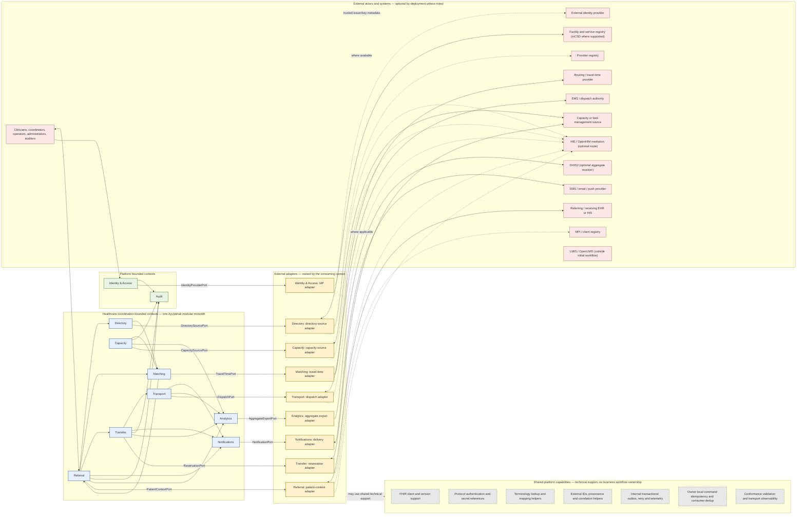

# Bounded Contexts and Context Map

AyuVahak begins as one deployable modular monolith. The contexts below define separate business language and ownership; they are not microservices. A context owns its facts, rules, and the application-facing ports that express what it needs from outside. Its adapters implement those ports. Other contexts use a published interface or event instead of reaching into private state.

FHIR, IPS, SMART, mCSD, DHIS2, HAPI, Spring, PostgreSQL/PostGIS, a routing provider, and an HIE are standards, platforms, or technologies. None is a business bounded context.

## Context definitions

### Directory

- **Purpose:** Discover organizations, facilities, locations, healthcare services, endpoints, and operational capability assertions relevant to coordination.
- **Owns:** The provenance-aware coordination projection and local directory corrections explicitly governed by a deployment.
- **Does not own:** National facility/provider identity, practitioner credentials, clinical service records, or live capacity.
- **Upstream dependencies:** Facility/provider registries, facility authorities, and DirectorySourcePort implementations such as an mCSD or local-registry adapter.
- **Downstream consumers:** Matching, Referral, Transfer, administrators, and authorized users.
- **Allowed communication:** Queries for candidate facts; attributed directory/capability change notifications; governed curation commands. Directory owns its source port and the meaning/mapping of external directory facts.
- **Events potentially published:** DirectoryEntryChanged, CapabilityProfileChanged, DirectorySourceBecameStale.
- **Prohibited coupling:** Do not treat directory presence or a listed service as current capacity/readiness; do not add patient identity matching.

### Capacity

- **Purpose:** Maintain and assess time-bounded observations of service capacity, availability, and readiness for coordination.
- **Owns:** Received/manual Capacity Observations, freshness classification, source attribution, and the current coordination projection.
- **Does not own:** Physical beds, staffing schedules, hospital resource planning, inventory, clinical admission, or the guarantee of real-world availability.
- **Upstream dependencies:** Capacity systems or locally designated capacity authorities through CapacitySourcePort implementations; Directory for service/facility identity.
- **Downstream consumers:** Matching and Transfer, with scoped operational views for authorized coordinators.
- **Allowed communication:** Accept attributed observations; answer freshness-aware queries; notify consumers when evidence changes or expires. Capacity owns its source port, observation interpretation, and business reconciliation rules.
- **Events potentially published:** CapacityObserved, CapacityBecameStale, CapacityWithdrawn, ReadinessChanged.
- **Prohibited coupling:** Never silently turn stale/unknown into available; do not own acceptance or reservation.

### Referral

- **Purpose:** Represent the originating team's request to coordinate care at another facility.
- **Owns:** Referral identity, origin, Care Requirement as supplied by a responsible clinician, minimum Patient Context/reference, urgency as asserted by the source, and the case-level Referral status summary; Transfer remains authoritative for reservation and movement details.
- **Does not own:** The source clinical chart, clinical assessment itself, destination matching policy, receiving Acceptance, Reservation, detailed Transfer lifecycle, or transport dispatch.
- **Upstream dependencies:** Authorized user or EHR/HIS through a patient-context adapter; Identity & Access; Directory; and Matching.
- **Downstream consumers:** Matching, Transfer, Notifications, and Audit.
- **Allowed communication:** Accept authorized create/update/cancel commands; request candidate evaluation; link to recommendation and Transfer status summary; consume Transfer events without duplicating its lifecycle; publish case facts. Referral owns PatientContextPort and any partner mapping for patient identity references or minimum case summaries.
- **Events potentially published:** ReferralCreated, CareRequirementChanged, ReferralCancelled, ReferralClosed, PatientContextUpdated.
- **Prohibited coupling:** Do not embed FHIR resources as the referral model; do not make a recommendation an automatic decision.

### Matching

- **Purpose:** Apply deterministic eligibility and ranking rules to a stated Care Requirement and attributed evidence.
- **Owns:** Versioned policy inputs, eligibility outcomes, ranking explanation, and the recommendation snapshot.
- **Does not own:** Clinical triage, source data, facility capacity, authorization, referral lifecycle, or the user's destination choice.
- **Upstream dependencies:** Referral's requirement; Directory; Capacity; TravelTimePort for an optional routing estimate; local matching policy.
- **Downstream consumers:** Referring clinician/operator through Referral.
- **Allowed communication:** Read versioned evidence; return eligible/ineligible/unknown reasons and an explainable ordered result; invalidate/recompute on material changes.
- **Events potentially published:** RecommendationProduced, RecommendationInvalidated.
- **Prohibited coupling:** No opaque/learned score, no hidden eligibility rule, no capacity mutation, and no autonomous clinical/destination/dispatch decision.

### Transfer

- **Purpose:** Coordinate a directed receiving request through response, reservation, movement, arrival, and clinical handover.
- **Owns:** Transfer Request state, separate clinical-suitability and operational-readiness confirmations, facility Acceptance/Reject/Timeout, Reservation outcome, Transfer lifecycle, cancellation/reroute history, Arrival, and Handover acknowledgement.
- **Does not own:** Referral's clinical source data, actual bed ledger unless an external system is the authority, vehicle dispatch, or subsequent clinical treatment.
- **Upstream dependencies:** Referral, Matching-selected destination, Directory, Capacity, locally mapped receiving-side authorities, and optionally a facility reservation system through a Transfer-owned reservation port.
- **Downstream consumers:** Referral, Transport, Notifications, Audit, and Analytics.
- **Allowed communication:** Create a Transfer planning record when a destination is selected, before reservation; record each separately attributed assessment and Acceptance; request and confirm a separate reservation; maintain one selected active transfer commitment per Referral; accept factual late arrival/handover reports.
- **Events potentially published:** TransferRequestIssued, DestinationAccepted, DestinationRejected, TransferReservationConfirmed, ReservationConflict, TransferCancelled, TransferRerouted, PatientArrived, HandoverAcknowledged, TransferCompleted.
- **Prohibited coupling:** Facility Acceptance follows positive clinical and operational confirmations; it is not a reservation, and a reservation is not admission. Do not let duplicate/delayed messages erase history or create two selected commitments.

### Transport

- **Purpose:** Coordinate and display the transport relationship needed for a Transfer.
- **Owns:** A transport request/reference, reported assignment and journey status, and coordination exceptions.
- **Does not own:** Fleet inventory, call taking, dispatch authority, vehicle tracking infrastructure, or medical control.
- **Upstream dependencies:** Transfer; DispatchPort implementations such as an EMS adapter, dispatcher, or attributed manual report.
- **Downstream consumers:** Transfer, Notifications, authorized referring/receiving teams, and Audit.
- **Allowed communication:** Record a transport need and, only when deployment policy explicitly authorizes the integration, send a purpose-limited request if supported; otherwise a human contacts dispatch out of band and records the sourced assignment/status. Transport owns the DispatchPort and the meaning/reconciliation of dispatch responses.
- **Events potentially published:** TransportRequested, TransportAssigned, TransportUnavailable, TransportStatusChanged, TransportCompleted.
- **Prohibited coupling:** Never issue a dispatch command unless a separately authorized future integration explicitly grants that role; transport failure does not silently cancel the Transfer.

### Notifications

- **Purpose:** Deliver coordination alerts and capture channel delivery outcomes.
- **Owns:** Recipient/channel choice allowed by policy, minimal message envelope, delivery attempts, and delivery/failure status.
- **Does not own:** Referral/transfer truth, user authorization, or proof that a human read/acted.
- **Upstream dependencies:** Events from Referral, Transfer, Transport, Identity & Access; NotificationPort implementations for configured gateways.
- **Downstream consumers:** Authorized users through approved channels; source contexts receive delivery outcome.
- **Allowed communication:** Consume an event; send a minimal notification; report attempt/failure via an explicit interface. Notifications owns its delivery port and delivery-outcome semantics.
- **Events potentially published:** NotificationSent, NotificationDeliveryFailed, NotificationExpired.
- **Prohibited coupling:** No clinical payload in generic push/email/SMS by default; delivery cannot change acceptance or reservation state.

### Identity & Access

- **Classification:** Platform bounded context, not a healthcare workflow context.
- **Purpose:** Map authenticated subjects to AyuVahak actors and enforce app-specific permissions.
- **Owns:** Issuer-scoped subject references, local role/organization grants, authorization decisions, and grant/revocation history. Authentication validates access-token identity; policy checks remain separate and use explicit organization and optional facility execution context.
- **Does not own:** Passwords, identity proofing, clinical credentials, or external registry identity.
- **Upstream dependencies:** External IdP through a domain-owned identity-provider port; deployment administrators. Provider/workforce registries may inform credentials but do not confer application permission.
- **Downstream consumers:** All user-facing and integration contexts.
- **Allowed communication:** Validate configured access-token issuer, audience, signature, and time bounds; evaluate scoped permission for actor, organization, optional facility, action, target/context, and purpose; emit attributable grant changes. Human and machine principals remain distinct. Shared protocol libraries are platform support.
- **Events potentially published:** AccessGrantChanged, AccessRevoked, AuthorizationDenied.
- **Prohibited coupling:** Authentication is not authorization; do not trust unverified claims or grant access merely because SMART/FHIR is present.

### Audit

- **Classification:** Platform bounded context, not a healthcare workflow context.
- **Purpose:** Preserve an accountable record of AyuVahak actions, access, decisions, and source attribution.
- **Owns:** The platform's audit chronology and governed audit views.
- **Does not own:** Partner-system audit logs, clinical documentation, or full payload copies.
- **Upstream dependencies:** Explicit audit facts from all contexts, Identity & Access, and integration metadata.
- **Downstream consumers:** Authorized auditors, security operators, and deployment governance.
- **Allowed communication:** Receive minimized action/access records through an explicit boundary; required mutation audit participates in the protected mutation transaction; non-mutating sensitive-read/security records use a separate durable path. Expose restricted audit queries and identify gaps/failures.
- **Events potentially published:** AuditRecordCaptured, AuditCaptureFailed, AuditAccessed.
- **Prohibited coupling:** No unbounded patient-content logging and no ordinary workflow path that claims completion when required audit capture failed.

### Analytics

- **Purpose:** Provide coordination-specific operational summaries and governed aggregate exports.
- **Owns:** Derived, minimized operational measures and aggregation definitions.
- **Does not own:** Patient-level operational workflow, public-health indicator definitions, generic BI, or clinical outcomes.
- **Upstream dependencies:** Approved Referral, Transfer, Capacity, Transport, and Directory events/views.
- **Downstream consumers:** Authorized facility/district coordinators, public-health reporting, DHIS2, and approved analytics tools.
- **Allowed communication:** Consume explicit, minimized facts; aggregate by governed dimensions; export approved indicators with quality/provenance metadata.
- **Events potentially published:** CoordinationIndicatorProduced, AggregateExportReady, AggregateExportFailed.
- **Prohibited coupling:** No direct reads across private context storage, no default patient-level case feed, and no feedback loop that changes safety-critical matching from analytics.

## Platform capabilities (distinct from healthcare business contexts)

Identity & Access and Audit are platform bounded contexts: they own the semantics and records of application authorization and AyuVahak's own audit chronology. They are not business workflow contexts such as Referral or Transfer. Provenance, correlation, event contracts, outbox delivery, command idempotency, and event-consumer deduplication are platform capabilities or owner-local mechanisms; none is a universal business-data store.

Interoperability is a shared platform capability, not a universal gateway and not a business bounded context. It supplies replaceable technical building blocks to adapters owned by the contexts that need external information or action. Those building blocks may include FHIR client/runtime support, protocol authentication, conformance validation, terminology lookup, external-correlation helpers, provenance metadata, transport-level retry scheduling, and transport observability. A deployment may route an adapter through an HIE/OpenHIM, but that route is optional and does not change semantic ownership.

The consuming business context owns its port, the meaning of the data or action requested, partner mapping, business retry/reconciliation policy, and the outcome it records. Specifically:

- Directory owns its directory-source port and mCSD or registry mappings.
- Referral owns its patient-context port and mapping/extraction of a scoped FHIR or IPS exchange into the minimum context it uses.
- Capacity owns its capacity-source and reservation semantics, including partner-specific capacity mappings.
- Matching owns its travel-time port and interpretation of any route estimate as advisory evidence.
- Transfer owns reservation requests and their business reconciliation; Transport owns dispatch requests and reported assignment/status.
- Notifications owns the notification-delivery port and the meaning of delivery outcomes.
- Identity & Access owns its identity-provider port and application authorization; shared protocol libraries do not authorize case actions.
- Analytics owns its governed aggregate export port and DHIS2 mapping.

External-system identifiers remain issued and authoritative within their source system. The context that owns the referenced AyuVahak concept owns the association to an external identifier, scoped by issuer and resource type. There is no central identifier-mapping business context. Shared terminology infrastructure may resolve codes, but the domain context owns what a code means for its rules and which local mappings are accepted.

Connection and mapping configuration is declared with the adapter that consumes it. Endpoint credentials are references to deployment-managed secrets, not stored in adapter configuration or source control. Operators may have a shared view of health and configuration ownership, but there is no centralized connector registry that owns every partner mapping or workflow. Country-specific mapping stays at the relevant adapter; jurisdiction-specific business policy remains owned by the accountable deployment and consuming domain.

Transport-level retries may be supplied by shared infrastructure only when duplicate delivery is safe and bounded. The owning context decides whether a business operation may be retried, what confirmation is required, how conflicts are reconciled, and when it can be considered complete. An outbox is technical delivery support; it does not transfer business-event ownership out of the publishing context.

## Context map

The diagram distinguishes business ownership from adapter implementation and shared platform support; it does not prescribe network topology. Each external adapter is logically owned by the context whose need it satisfies. Shared platform capabilities support several adapters and do not mediate every external call through one central business service. An HIE/OpenHIM may carry a particular exchange where the deployment uses it. It does not make AyuVahak mandatory if another system already owns the coordination lifecycle. LMIS is shown as a neighboring authority only; no routine dependency or exchange is part of the initial workflow.

## Communication and modularity rules

- Keep contexts in one deployable modular monolith initially, with clear ownership and narrow interfaces.
- Use direct in-process queries/commands where a synchronous decision needs an answer. Do not distribute contexts into separately deployed services without an identified scaling, isolation, or organizational need.
- Use domain events when another context needs to react to a committed fact. Events are notifications of facts, not the only record of truth.
- Use a transactional outbox where a committed fact must reliably reach an asynchronous internal consumer. A pending publication is visible and retryable; it does not roll back the committed fact. The platform outbox is not a generic external integration gateway; partner delivery remains behind the owning context's adapter and reconciliation boundary.
- Outbox delivery is at least once. Per-aggregate order is enforced when required; no global event ordering is promised. Consumers deduplicate at their own effect boundary.
- Command idempotency and consumer deduplication are separate: command owners store scoped command receipts, and each consumer owns receipts for its own effect. No generic cross-context receipt store is exposed.
- Required audit for a protected mutation commits atomically with that mutation. Non-mutating sensitive-read and security outcomes use a separate durable audit path with explicit fail-closed behavior.
- Do not use full event sourcing. Keep the current owned state plus an auditable event history appropriate to the domain.
- Add CQRS only when a query/read view has a demonstrated need; no separate distributed read/write system initially.
- Keep persistence private to its owning context; avoid shared tables, direct cross-context reads/joins, and cross-context mutation. Use exported interfaces or events/projections.
- Keep external adapters with the context that owns the port and mapping. No business context may call an unrelated adapter or bypass its port to use a partner directly.
- Shared platform helpers must remain protocol-level and reusable. They must not own domain mappings, business retry decisions, or workflow state.
- Introduce a seam where an external system or policy actually varies. Keep adapters replaceable, but avoid abstractions with no real variation or caller benefit.
- No mandatory Kafka or Kubernetes. Docker Compose remains a first-class path for local and small deployments.

