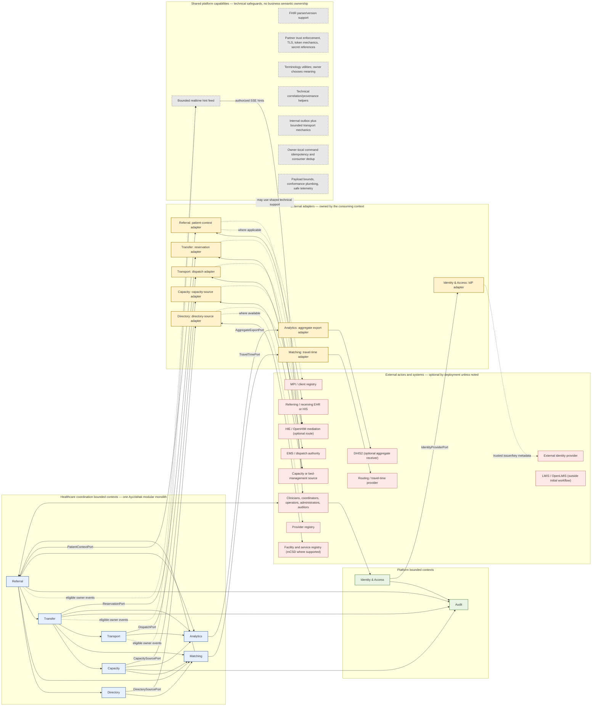

# Bounded Contexts and Context Map

AyuVahak begins as one deployable modular monolith. The contexts below define separate business language and ownership; they are not microservices. A context owns its facts, rules, and the application-facing ports that express what it needs from outside. Its adapters implement those ports. Other contexts use a published interface or event instead of reaching into private state.

FHIR, IPS, SMART, mCSD, DHIS2, HAPI, Spring, PostgreSQL/PostGIS, a routing provider, and an HIE are standards, platforms, or technologies. None is a business bounded context.

## Context definitions

Volume II's implemented business contexts are Directory, Capacity, Referral, Matching, and Transfer. They were implemented sequentially in Phases 3–7. Volume III adds standards/exchange adapters and Transport as a distinct business context. Phases 8–10 are implemented and frozen. Volume IV adds Phase 11's technical realtime notification and federation capabilities and Phase 12's Analytics context for reproducible aggregate reporting and downstream DHIS2 exchange. The [Volume II context map](volume-2-core-care-coordination.md#context-model) shows the frozen five-context collaboration; [Volume III architecture](volume-3-interoperability-security-transport.md) and [Volume IV architecture](volume-4-resilient-operations-federation-public-health.md) define the approved extensions.

### Directory

- **Purpose:** Discover coordination-relevant Organizations, Facilities, Locations, HealthcareServices, and attributed CareCapability assertions.
- **Owns:** A provenance-aware coordination projection and governed local corrections; issuer-scoped external identifier associations for the Directory concepts.
- **Does not own:** National facility/provider identity, practitioner credentials, authoritative registry records, patient identity, or Capacity.
- **Upstream dependencies:** Optional facility/service authorities and a context-owned `DirectorySourcePort`; manual curation remains supported.
- **Downstream consumers:** Matching and authorized directory users; Referral/Transfer use only the identity/origin facts they need.
- **Allowed communication:** Scoped curation commands and bounded discovery/fact queries. Directory owns its source mapping and semantics.
- **Events:** None in the Volume II baseline. Matching queries current Directory facts synchronously; add an event only when a real asynchronous consumer is designed.
- **Prohibited coupling:** A service/capability assertion is not current Capacity or Readiness; no patient identity matching and no authoritative registry write-back by default.

### Capacity

- **Purpose:** Maintain and evaluate time-bounded operational evidence for coordination.
- **Owns:** Received/manual Capacity Observations, source/freshness/conflict interpretation and current projection; in Phase 7, time-bounded coordination Reservations and their lifecycle.
- **Does not own:** Physical beds, staffing schedules, resource planning, inventory, clinical admission, or guarantee of real-world availability.
- **Upstream dependencies:** Optional capacity sources through a Capacity-owned port; Directory's application boundary for Facility identity/reference validation.
- **Downstream consumers:** Matching and Transfer through freshness-aware query/command contracts; authorized operational views.
- **Allowed communication:** Observation intake, evidence/readiness queries, and Capacity-owned reservation command/status/release. Capacity owns source mapping and business reconciliation.
- **Events:** No observation/readiness event is emitted in Phase 4 without a consumer. Phase 7 publishes reservation-expired, reservation-at-risk, and reservation-recovered events to Transfer for reservation lifecycle reconciliation.
- **Prohibited coupling:** Never turn stale/unknown into positive availability; Reservation is a coordination hold, not a bed ledger; do not own receiving Acceptance.

### Referral

- **Purpose:** Represent the origin team's cross-facility coordination request and structured care requirement.
- **Owns:** Referral identity/origin, immutable submitted revisions, source-asserted CareRequirement, opaque PatientReference, and Referral status/resolution. Transfer owns attempts, Acceptance and movement details.
- **Does not own:** Patient identity resolution, clinical chart or summary, diagnosis/inference, Matching policy, Acceptance, Reservation, Transfer lifecycle, or dispatch.
- **Upstream dependencies:** Authorized origin user/system, Directory for origin/capability validation, and a later context-owned patient-reference adapter only if selected.
- **Downstream consumers:** Matching and Transfer through narrow queries; Transfer cancellation/completion facts return through idempotent commands/events.
- **Allowed communication:** Scoped create/submit/amend/cancel/resolve; read immutable revisions; expose only minimum basis fields to Matching/Transfer. Referral owns any future patient-context mapping.
- **Events:** `referral.cancelled.v1` is published for Transfer. No other Referral event is included until a real consumer exists.
- **Prohibited coupling:** No FHIR resource as the domain model, no patient warehouse, no automatic recommendation/decision, no direct Transfer internals.

### Matching

- **Purpose:** Evaluate explicit hard eligibility and produce a deterministic, advisory ordering from current evidence.
- **Owns:** Versioned matching policy, including the CareCapability-to-CapacityDimension operational requirement mapping, and immutable structured Recommendation snapshots/outcomes.
- **Does not own:** Clinical triage/suitability, source Directory/Capacity facts, Referral lifecycle, destination decision, Acceptance, Reservation, or transport.
- **Upstream dependencies:** Referral revision, Directory candidate/capability/location queries, Capacity readiness query, Phase 2 Identity & Access for the human `RecommendationRequest` authority and the dedicated service identity, Audit, optional Matching-owned TravelTimePort, and deployment policy.
- **Downstream consumers:** Authorized origin-side users and Transfer's recommendation query.
- **Allowed communication:** The human explicitly requests evaluation under origin scope; Matching's separate machine identity performs synchronous owner queries under exact owner grants, never inheriting the human's permissions. Resolve Referral CareCapabilities through the Matching policy, then ask Capacity's bounded batch contract to evaluate only the resulting dimensions; preserve policy/evidence versions, candidate outcomes, freshness and rationale. Transfer invokes synchronous applicability revalidation before a request.
- **Events:** None in Volume II. Current applicability is determined by targeted synchronous owner queries; no speculative invalidation event.
- **Prohibited coupling:** No opaque/learned score, no unknown-as-negative or positive, no direct source tables, no capacity mutation and no autonomous clinical/destination decision.

### Transfer

- **Purpose:** Coordinate a directed receiving request through decision, separate reservation, reported movement, Arrival, Handover, and closure.
- **Owns:** TransferJourney and ordered request attempts, separate receiving assessments and Acceptance, its own Transfer lifecycle/event history, and the referenced outcome of Capacity-owned Reservation.
- **Does not own:** Referral/clinical source data, Capacity ledger or reservation state, actual bed/admission, transport dispatch/fleet, or subsequent treatment.
- **Upstream dependencies:** Referral revision/state, current Matching snapshot, Directory destination facts, Capacity reservation application contract, and locally mapped receiving authorities.
- **Downstream consumers:** Referral (only completion/unfulfilled/cancellation reactions); Transport and Analytics have separately governed contracts.
- **Allowed communication:** Create one active request at a time, record authority functions separately, invoke Capacity command, reconcile outcomes, preserve reroute and late factual reports.
- **Events:** Receives `referral.cancelled.v1`, `capacity.reservation-expired.v1`, `capacity.reservation-at-risk.v1`, and `capacity.reservation-recovered.v1`; publishes `transfer.completed.v1` and `transfer.unfulfilled.v1` to Referral. A recovery event restores the recorded Capacity outcome; when Transfer has progressed beyond `COORDINATION_EXCEPTION`, Transfer progress is preserved.
- **Prohibited coupling:** Acceptance is not Reservation; Reservation is not admission; no direct Capacity tables; no message delivery changes a receiving decision; no two active destination commitments.

### Transport

**Phase status:** Phase 10 implementation is frozen under the Volume III design and Phase 10 specification. Transport is not part of frozen Phases 3–7. In Volume II, Transfer records only an attributed reported `IN_TRANSIT` state and does not claim to coordinate or control transport; the Phase 10 Transport context owns its separate movement coordination facts.

- **Purpose:** Coordinate and display the transport relationship needed for a Transfer.
- **Owns:** A separate TransportRequest, provider-scoped assignment reference, attributed ETA/status/movement observations, cancellation/reconciliation outcome, provider/manual destination-change operation, and transport coordination exceptions. Provider systems remain authoritative for vehicles, crews, and dispatch algorithms. Transfer remains owner of destination-change intent and final active destination.
- **Does not own:** Fleet inventory, call taking, dispatch authority, vehicle tracking infrastructure, or medical control.
- **Upstream dependencies:** Transfer owner contracts; an optional DispatchPort implemented by a partner adapter or a human/manual reporting path. Phase 9 supplies technical trust safeguards for any external adapter.
- **Downstream consumers:** Transfer, authorized referring/receiving teams, realtime notification hints, and Audit.
- **Allowed communication:** Receive purpose-limited request/cancel/destination-change commands from Transfer after independent service-grant validation and the named Transfer-owned eligibility query. Use a configured DispatchPort only where a deployment authorizes it; otherwise record authorized manual coordination. Transport maps provider responses and owns status reconciliation. Transfer records its own movement and applies its own destination change only through validated owner contracts/events.
- **Events potentially published:** `transport.cancellation-resolved.v1`, `transport.destination-change-resolved.v1`, `transport.departure-confirmed.v1`, `transport.arrival-reported.v1`, `transport.interrupted.v1`, and `transport.unfulfilled.v1`, each only for a named Transfer consumer and purpose. No event-per-state stream.
- **Prohibited coupling:** No Transfer persistence access; no patient clinical context; no implicit dispatch authority; assignment, ETA, and vehicle arrival do not imply Transfer departure, Arrival, Handover, or Completion; transport failure does not silently cancel or reroute Transfer.

### Realtime notification feed

**Classification:** Implemented Phase 11 platform capability, not a business bounded context.

- **Purpose:** Tell an authorized client that a scoped owner resource may have changed.
- **Owns:** Only a bounded cursor/replay projection if needed. It owns no business state and no general SMS/email/push delivery lifecycle.
- **Does not own:** Referral/Transfer truth, authorization grants, resource state, or proof that a human read/acted.
- **Upstream dependencies:** Eligible committed owner events through the internal outbox; current scope authorization is delegated to Identity & Access.
- **Downstream consumers:** Authenticated clients over optional SSE; clients fetch current owner state through ordinary APIs.
- **Allowed communication:** Publish minimal resource/version/sequence hints. A cursor outside the replay window or reset epoch requires full refresh.
- **Events potentially published:** None required; a hint is not a new domain event.
- **Prohibited coupling:** No PatientReference/clinical payload, permanent UI event history, external provider delivery, blocking owner/outbox worker, or state transition based on delivery/receipt.

### Identity & Access

- **Classification:** Platform bounded context, not a healthcare workflow context.
- **Purpose:** Map authenticated subjects to AyuVahak actors and enforce app-specific permissions.
- **Owns:** Issuer-scoped subject references, local role/organization grants, authorization decisions, and grant/revocation history. Authentication validates access-token identity; policy checks remain separate and use explicit organization and optional facility execution context.
- **Does not own:** Passwords, identity proofing, clinical credentials, or external registry identity.
- **Upstream dependencies:** External IdP through a domain-owned identity-provider port; deployment administrators. Provider/workforce registries may inform credentials but do not confer application permission.
- **Downstream consumers:** All user-facing and integration contexts.
- **Allowed communication:** Validate configured access-token issuer, audience, signature, and time bounds; evaluate scoped permission for actor, organization, optional facility, action, target/context, and purpose; emit attributable grant changes. Human and machine principals remain distinct. Shared protocol libraries are platform support.
- **Events potentially published:** AccessGrantChanged, AccessRevoked, AuthorizationDenied.
- **Prohibited coupling:** Authentication is not authorization; do not trust unverified claims or grant access merely because SMART/FHIR is present.

### Audit

- **Classification:** Platform bounded context, not a healthcare workflow context.
- **Purpose:** Preserve an accountable record of AyuVahak actions, access, decisions, and source attribution.
- **Owns:** The platform's audit chronology and governed audit views.
- **Does not own:** Partner-system audit logs, clinical documentation, or full payload copies.
- **Upstream dependencies:** Explicit audit facts from all contexts, Identity & Access, and integration metadata.
- **Downstream consumers:** Authorized auditors, security operators, and deployment governance.
- **Allowed communication:** Receive minimized action/access records through an explicit boundary; required mutation audit participates in the protected mutation transaction; non-mutating sensitive-read/security records use a separate durable path. Expose restricted audit queries and identify gaps/failures.
- **Events potentially published:** AuditRecordCaptured, AuditCaptureFailed, AuditAccessed.
- **Prohibited coupling:** No unbounded patient-content logging and no ordinary workflow path that claims completion when required audit capture failed.

### Analytics

**Volume IV status:** Analytics is implemented for Phase 12 as an aggregate-only reporting context. It owns versioned indicator definitions, reproducible aggregate snapshots/revisions, disclosure decisions and reservations, approved DHIS2 mappings, and technical export operations. It consumes bounded owner reporting contracts; it does not own operational facts or patient records and does not query private owner schemas directly.

- **Purpose:** Compute reproducible, minimized aggregate operational reporting and deliver approved values to configured DHIS2 targets.
- **Owns:** Immutable indicator versions, derived aggregate snapshots/revisions, source completeness, privacy/suppression decisions, target mapping versions, and export-operation outcomes.
- **Does not own:** Referral/Transfer/Capacity/Transport facts, patient records, clinical outcomes, generic BI, or DHIS2 metadata.
- **Upstream dependencies:** Bounded reporting snapshot contracts produced by each approved owner; Phase 9 technical exchange for outbound DHIS2 delivery.
- **Downstream consumers:** Authorized reporting operators and configured DHIS2 partner only.
- **Allowed communication:** Request approved owner measures for explicit period/scope; aggregate compatible complete snapshots; export aggregate DataValueSets through Phase 9.
- **Events potentially published:** Only explicitly justified reporting/export events once a consumer is named; the design does not require generic event-per-snapshot publication.
- **Prohibited coupling:** No private schema/repository access, no patient/case IDs, no Tracker/Event export, no implicit zero, no target metadata mutation by default, no operational feedback loop, and no DHIS2 source-of-truth role.

## Platform capabilities (distinct from healthcare business contexts)

Identity & Access and Audit are platform bounded contexts: they own the semantics and records of application authorization and AyuVahak's own audit chronology. They are not business workflow contexts such as Referral or Transfer. Provenance, correlation, event contracts, outbox delivery, command idempotency, and event-consumer deduplication are platform capabilities or owner-local mechanisms; none is a universal business-data store.

Interoperability is a shared platform capability, not a universal gateway and not a business bounded context. Phase 8 adds owner-context adapters; Phase 9 adds shared partner trust enforcement and exchange transport. The capability supplies replaceable technical building blocks such as bounded HTTP/TLS, configured protocol authentication, parser/validation plumbing, terminology utilities, correlation, and transport observability. It does not own partner semantics, a business mapping, external identifier association, reconciliation outcome, or all connections. A deployment may route a particular adapter through an HIE/OpenHIM, but that route is optional and does not change semantic ownership.

The consuming business context owns its port, the meaning of the data or action requested, partner mapping, business retry/reconciliation policy, and the outcome it records. Specifically:

- Directory owns its directory-source port and mCSD or registry mappings.
- Referral owns its patient-context port and mapping/extraction of a scoped FHIR or IPS exchange into the minimum context it uses.

## Volume IV design boundary

Phase 11 keeps owner databases authoritative, uses optional bounded SSE hints with authorized refresh, and federates named owner operations through Phase 9 without shared storage or multi-master replication. Its implementation is frozen; see the [Phase 11 acceptance record](../reviews/phase-11-acceptance.md). Phase 12 introduces Analytics as a derived aggregate context with owner-produced reporting snapshots and a downstream DHIS2 DataValueSet adapter. Missing/partial facts are never zero, aggregate privacy requires configured policy, and public DHIS2 is never a test dependency. See [Volume IV architecture](volume-4-resilient-operations-federation-public-health.md), [contracts](volume-4-context-contracts.md), [state machines](volume-4-state-machines.md), and [data ownership](volume-4-data-ownership.md), plus the [Phase 11](../specs/phase-11-real-time-resilience-federation-spec.md) and [Phase 12](../specs/phase-12-public-health-analytics-dhis2-spec.md) specifications.
- Capacity owns its source-to-CapacityDimension mappings and reservation semantics. Matching owns CareCapability-to-CapacityDimension operational-requirement policy; Capacity does not infer CareCapability meaning.
- Matching owns its travel-time port and interpretation of any route estimate as advisory evidence.
- Transfer owns reservation requests and their business reconciliation; Transport owns dispatch requests and reported assignment/status.
- Phase 11's notification feed owns only bounded client hints; it does not own channel delivery or business meaning.
- Identity & Access owns its identity-provider port and application authorization; shared protocol libraries do not authorize case actions.
- Analytics owns its governed aggregate export port and DHIS2 mapping.

External-system identifiers remain issued and authoritative within their source system. The context that owns the referenced AyuVahak concept owns the association to an external identifier, scoped by issuer and resource type. There is no central identifier-mapping business context. Shared terminology infrastructure may resolve codes, but the domain context owns what a code means for its rules and which local mappings are accepted.

Owner-specific connection use, profile mapping, external identifiers, and operation semantics remain declared with the adapter that consumes them. A shared, administrator-controlled trust envelope may centralize only technical partner identity, approved origin/host/path policy, authentication mode, trust status, limits, and secret/key references so every adapter receives the same enforcement. That envelope is not a connector registry and contains no owner mapping or business workflow. Secret material remains outside ordinary configuration and source control. Country-specific mapping stays at the relevant adapter; jurisdiction-specific policy remains with the accountable deployment and consuming domain.

Transport-level retries may be supplied by shared infrastructure only when duplicate delivery is safe and bounded. The owning context decides whether a business operation may be retried, what confirmation is required, how conflicts are reconciled, and when it can be considered complete. An outbox is technical delivery support; it does not transfer business-event ownership out of the publishing context.

## Context map

This diagram shows the context map for Volumes I–IV. It does not represent implementation status or authorize implementation. The frozen Volume II phase order and event catalog remain in the [Volume II architecture](volume-2-core-care-coordination.md) and [context contracts](volume-2-context-contracts.md); Volume III and IV boundaries are detailed in their architecture, contracts and specifications.

The diagram distinguishes business ownership, platform capability, adapter, and external system; it does not prescribe network topology. Each external adapter is logically owned by the context whose need it satisfies. Shared trust enforcement may be common, but every adapter calls it with a preconfigured partner/operation reference and keeps its own meaning and outcome. There is no universal `InteropService`. An HIE/OpenHIM may carry a particular exchange where deployed; it is not mandatory. LMIS remains outside this volume's coordination workflow.

## Communication and modularity rules

- Keep contexts in one deployable modular monolith initially, with clear ownership and narrow interfaces.
- Use direct in-process queries/commands where a synchronous decision needs an answer. Do not distribute contexts into separately deployed services without an identified scaling, isolation, or organizational need.
- Use domain events when another context needs to react to a committed fact. Events are notifications of facts, not the only record of truth. An event may precede its executable consumer only when the same approved Volume design freezes the consumer, purpose, ownership, payload/privacy boundary, and delivery/activation behavior; otherwise do not emit for a hypothetical consumer.
- Use a transactional outbox where a committed fact must reliably reach an asynchronous internal consumer. A pending publication is visible and retryable; it does not roll back the committed fact. The platform outbox is not a generic external integration gateway; partner delivery remains behind the owning context's adapter and reconciliation boundary.
- Outbox delivery is at least once. Per-aggregate order is enforced when required; no global event ordering is promised. Consumers deduplicate at their own effect boundary.
- Command idempotency and consumer deduplication are separate: command owners store scoped command receipts, and each consumer owns receipts for its own effect. No generic cross-context receipt store is exposed.
- Required audit for a protected mutation commits atomically with that mutation. Non-mutating sensitive-read and security outcomes use a separate durable audit path with explicit fail-closed behavior.
- Do not use full event sourcing. Keep the current owned state plus an auditable event history appropriate to the domain.
- Add CQRS only when a query/read view has a demonstrated need; no separate distributed read/write system initially.
- Keep persistence private to its owning context; avoid shared tables, direct cross-context reads/joins, and cross-context mutation. Use exported interfaces or events/projections.
- Keep external adapters with the context that owns the port and mapping. No business context may call an unrelated adapter or bypass its port to use a partner directly.
- Shared platform helpers must remain protocol-level and reusable. They must not own domain mappings, business retry decisions, or workflow state.
- Introduce a seam where an external system or policy actually varies. Keep adapters replaceable, but avoid abstractions with no real variation or caller benefit.
- No mandatory Kafka or Kubernetes. Docker Compose remains a first-class path for local and small deployments.

