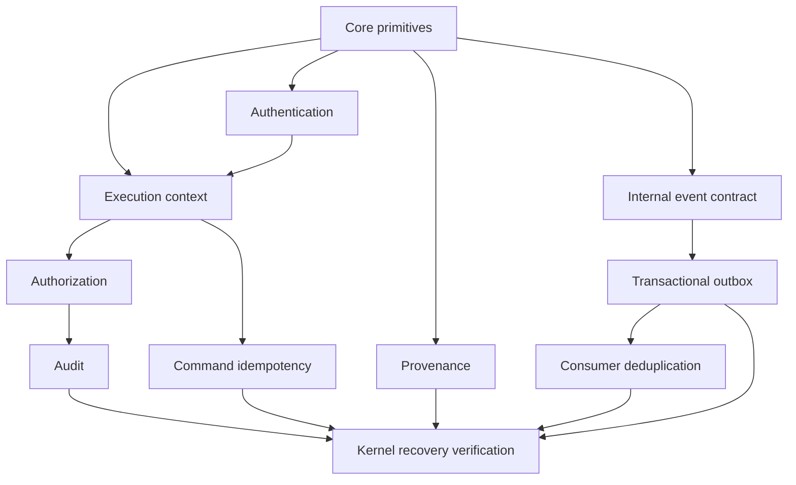
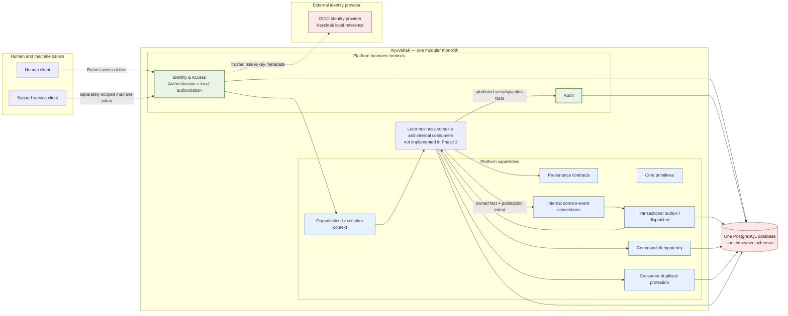
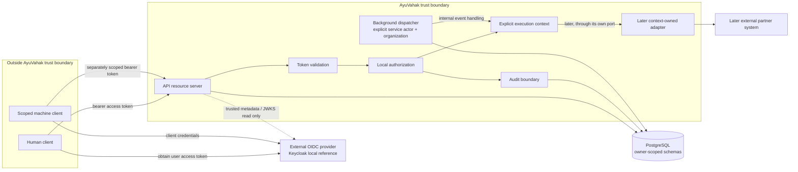

# Phase 2 — Platform Kernel, Identity & Trust

**Status:** Phase 2 architecture baseline, approved for specification. Phase 1 is frozen; Phase 2 has not started.

This document turns the frozen product boundaries and Phase 0 decisions into a coherent Phase 2 architecture. It defines the platform kernel that later business contexts can rely on. It does not define healthcare business aggregates, production table layouts, API endpoints, event payloads, or deployment topology. The companion [Phase 2 specification](../specs/phase-2-platform-kernel-spec.md) defines observable capabilities and verification seams without creating tickets.

## Purpose and boundaries

Phase 2 establishes the shared trust and reliability foundations required before business workflows are implemented: domain primitives, explicit organization execution context, external authentication, AyuVahak-owned authorization, attributable audit, provenance support, internal domain-event conventions, reliable event publication, command idempotency, consumer duplicate protection, and kernel-level recovery behavior.

It remains one modular monolith. The modules below are code ownership boundaries, not independently deployed services. The boundary rules in [bounded contexts](bounded-contexts.md) remain in force. A module does not gain ownership of another module's facts because it provides shared infrastructure.

Phase 2 does not implement Directory, Capacity, Referral, Matching, Transfer, Transport, Notifications, Analytics, healthcare interoperability, user interfaces, offline synchronization, federation, or business workflows. The only executable data needed to verify the kernel belongs to kernel capabilities or test-only fixtures. Business schemas and business event contracts are introduced only by their owning later phase.

## Ten module responsibilities

| Module | Owns | Does not own | Persistence expectation |
| --- | --- | --- | --- |
| Core primitives | Opaque internal identifier conventions, issuer-scoped external references, explicit time abstractions, correlation/causation concepts, and small immutable value concepts shared where semantics are truly universal. | Business identity, generic entity inheritance, clinical concepts, authorization decisions, or a catch-all shared domain model. | No shared kernel data store. Persisted values remain in the schema of the owning context. |
| Organization / execution context | The validated organization and optional facility under which an action is attempted; actor kind/reference, request/source kind, and correlation context. | Authentication, membership policy, or a user-selected organization treated as trusted without server validation. | No independent authoritative organization registry. Context references an organization identity owned by the deployment directory/authority; membership/grant records belong to Identity & Access. |
| Authentication | Provider-neutral validation of human access tokens and separately scoped machine access tokens at the API resource-server boundary. | Login UI, password storage, patient identity, application authorization, client session/BFF architecture, or identity-provider administration. | No token/session persistence. Only trusted issuer configuration and key-discovery metadata are configured/cached according to safe provider rules; issuer and subject references may be retained by owning attribution records. |
| Authorization | AyuVahak-owned organization-scoped grants, role-to-functional-authority policy evaluation, denial behavior, and a path to attribute-based rules. | Provider credential verification, professional licensure, health-system identity master data, or universal job-title mappings. | Identity & Access owns grant state and attributable grant/revocation history in its logical schema. Decisions use explicit execution context; no other context reads these records directly. |
| Audit | Restricted, attributable chronology of safety/access-relevant actions, access outcomes, grant administration, and audit access. | Operational logs, domain-event delivery state, a copy of clinical records, or provenance for every business datum. | Audit owns append-oriented records in its logical schema. Mutation evidence shares the protected mutation transaction; non-mutating security records use the separately specified durable path. |
| Provenance | A reusable vocabulary and capture contract for source, actor/system, observation/receipt time, transformation, verification, and source-scoped references attached to facts. | A centralized store that republishes or owns business facts, raw FHIR snapshots, or audit chronology. | Provenance is stored with the fact in the owner context. No global provenance database. |
| Domain-event framework | Internal event identity, naming/versioning convention, metadata contract, and producer/consumer boundary rules. The producing business context owns event meaning. | System of record, event-sourced state, global ordering, an external message broker, or a universal event catalog that owns business semantics. | Event facts are created in the producer's state transaction; delivery metadata is handled by the outbox capability. No generic event archive is introduced. |
| Transactional outbox / dispatcher | Durable publication intent, claim/lease/recovery, retry state, publication ordering per aggregate where required, and operational failure visibility. | Business meaning, destination decision, consumer deduplication, or a distributed transaction with a partner. | Platform-owned delivery metadata is stored separately from business-owned source state. A producer records the event and its publication intent in one database transaction. No shared data store exposes business state. |
| Idempotency and duplicate protection | Two distinct boundaries: command owners protect caller retries with scoped key/fingerprint and safe replay; each event consumer durably recognizes its own completed effect. | Conflating command retry with consumer redelivery, arbitrary exactly-once guarantees, or ownership of another context's business result. | Command receipts belong to the command-owning context; consumer receipts belong to each consumer-owning context. Phase 2 proves both with test-only fixtures and creates no empty business schema. |
| Kernel failure/recovery verification | Cross-cutting local acceptance harness for authentication, authorization, audit, provenance, event/outbox, idempotency, concurrency, and restart failures. | Production business scenarios, a production business owner/consumer, public-system testing, or a new runtime service. | Test fixtures use disposable local PostgreSQL/PostGIS, local Keycloak where protocol behavior is under test, deterministic tokens/publishers, and synthetic data. No production schema or business state is owned by the harness. |

These ten Phase 2 work modules may share libraries or process infrastructure where the dependency is inward and explicit; they do not require ten Spring modules or ten database schemas. The tenth module is a cross-cutting verification capability, not a production bounded context. Command idempotency and consumer deduplication remain separately owned mechanisms within the combined ninth module.

## Conceptual boundary contracts

These are language-neutral contracts, not Java interface declarations or business payload designs. A Phase 2 implementer may choose concrete types and package seams only after preserving these ownership and failure properties.

| Boundary | Conceptual input | Conceptual result | Required boundary behavior |
| --- | --- | --- | --- |
| Core primitives | Identifier, external issuer/source, time, correlation, or causation value | Validated opaque value with preserved scope/meaning | No global service or persistence; an external ID is always issuer/resource scoped. |
| Execution context | Verified actor reference plus proposed organization and optional facility scope | Validated explicit context for one operation | Reject missing, untrusted, or unauthorized scope. Callers and background jobs provide it explicitly. |
| Authentication | Presented bearer access token and trusted provider configuration | Verified human/service actor reference and identity evidence | Validate issuer, audience, signature/key, and time locally; reject ID Tokens and malformed/unverifiable credentials. Output carries no application allow decision. |
| Authorization | Verified actor, validated execution context, action, target/context, and relevant purpose | Allow/deny result with safe decision provenance | Deny by default; evaluate AyuVahak grants independently of token validity; do not expose policy internals to an untrusted caller. |
| Audit | Minimized action record plus transaction mode | Durable audit outcome or explicit failure | Mutation records join the protected transaction. Sensitive-read/security records use separate durable capture and block disclosure/false success when unavailable. |
| Provenance | Fact plus source, actor/system, observed/received time, and relevant transformation/verification | Fact-associated provenance | Preserve the fact owner and source; never create a centralized copy of all data. |
| Event contract | Producer-owned committed fact and required attribution | Versioned internal event envelope | Producer controls meaning and version. No automatic raw-payload serialization or external delivery. |
| Outbox/dispatcher | Event envelope plus publication intent in the producer transaction | At-least-once internal delivery attempts and recoverable state | Atomic intent, restart recovery, visible failure, monotonic per-aggregate order where required, no global ordering guarantee. |
| Command idempotency | Command owner, actor/client, organization, operation/target scope, key, and normalized fingerprint | New execution, same committed result, conflict, or recoverable in-progress outcome | One effect under concurrency; same key/different input conflicts; receipt holds a safe result reference, not raw body. |
| Consumer duplicate protection | Consumer identity, event identity, and consumer-owned effect | Applied once per consumer effect, or retryable failure | Receipt and effect are atomic where transactional; duplicate is acknowledged only after prior effect completion. |

An implementation must not turn these conceptual contracts into public HTTP APIs or independently deployed services unless a later, evidence-backed decision explicitly requires that boundary. The companion Phase 2 specification is that decision for only three operational needs: post-bootstrap grant administration, restricted audit review, and stalled internal-event recovery. Their minimal protected routes are specified there because the deployment needs an attributable, authenticated path to manage grants, inspect audit evidence, and recover outbox delivery. The bootstrap command remains local and non-web. No other Phase 2 route or service extraction is approved.

## Dependency graph and concurrency boundaries

Core primitives are the only hard prerequisite for the other capabilities. Authentication and the event-contract vocabulary can be developed independently after core. Execution context combines a verified actor with a scope; authorization depends on it. Audit depends on actor/context and authorization outcomes. Provenance is orthogonal to authentication and can proceed after core. Outbox depends on the event contract and Phase 1 PostgreSQL transaction foundation. Command idempotency depends on explicit actor/scope context; consumer dedup depends on event identity and the consumer's own effect. The cross-cutting recovery harness integrates all branches last. These are dependency seams, not tickets or an instruction to parallelize without ownership.

The only initial database is the existing PostgreSQL database. Phase 2 reserves these **logical schema owners**, without defining or creating DDL here:

| Logical schema owner | Data boundary |
| --- | --- |
| `identity_access` | Issuer-scoped subject references, scoped grants and revocation state, one-shot bootstrap marker, and idempotency receipts for its own grant commands. No passwords, access tokens, or sessions. |
| `audit` | Minimized, restricted audit chronology and query-support state. Mutation audit participates in the caller's database transaction. |
| `platform_eventing` | Internal event envelopes, outbox delivery/lease/retry/replay state, and idempotency receipts for its own replay operation; no business fact or consumer effect. |
| Business-context schema | Later command idempotency receipts and event-consumer receipts, kept with the context that owns each effect. No schema is created until that business owner exists. |

Core primitives, execution context, and provenance add no standalone shared schema. Provenance stays with each owning fact. There is no generic `shared` schema or central command/consumer receipt schema. Test-only fixtures may use a clearly named test schema; it is not part of production schema ownership.

Concurrent command retries must converge using PostgreSQL transaction/uniqueness/locking semantics appropriate to the operation. Competing outbox workers coordinate through PostgreSQL claim/lease state. Do not add a distributed lock. The Phase 2 specification fixes the initial lock/lease/retry contract and requires acceptance tests for concurrent duplicate commands, competing workers, crash recovery, and independent aggregate progress against real PostgreSQL. No claim is made that phase-level load capacity is known before representative benchmarks.

## System shape and module map

The map distinguishes platform bounded contexts from technical capabilities. Identity & Access and Audit are platform bounded contexts because they own policy/grant and audit-record semantics. Provenance, event contracts, outbox delivery, and duplicate-protection mechanisms are platform capabilities; they do not become healthcare business contexts. External providers remain adapters or systems at the boundary.

The diagram is logical: the database is one deployment resource with private schema ownership, not a shared business data API. A dotted IdP relationship means the API validates tokens locally using trusted configuration/key material; it does not introspect each request or send patient context to the IdP.

### Phase 2 trust boundary

The future browser/client flow is intentionally unspecified: the client obtains a token from the external IdP, then presents the access token to AyuVahak. Machine identity is separately scoped. AyuVahak retrieves only trusted issuer/key metadata; no patient-level data or credentials are sent to the IdP. Background work has its own service actor and explicit organization scope, never a copied human authority. Audit remains within the AyuVahak boundary and uses the same database for atomic mutation evidence; partner communication appears only at a later context-owned adapter boundary.

## Allowed dependency and communication rules

- API authentication establishes a verified actor reference. Authorization evaluates a protected operation using that actor and a server-validated execution context. A valid token never grants a business permission by itself.
- A request's organization and optional facility are explicit inputs. The server validates that the authenticated subject or machine grant can act in that scope. Background work carries an explicit service actor and organization scope; it does not inherit an ambient request thread context.
- Business contexts own commands, their external ports, their facts, their event semantics, and their reconciliation rules. Phase 2 provides no business context with permission to query another context's internal tables.
- A domain event reports a committed fact. Its producer context defines and versions the fact. The platform event framework supplies common envelope rules only.
- The outbox stores delivery intent and state. It does not own or alter the business outcome. If publication fails after the owning transaction commits, that outcome remains committed and delivery stays recoverable and visible.
- Command idempotency is checked at the command boundary. Consumer deduplication is checked at each consumer's effect boundary. They are related defenses, not one shared store or one universal key.
- Audit callers submit explicit, minimized audit facts through the Audit boundary; other contexts do not write Audit's persistence directly. Audit does not become an event archive or a source of clinical truth.
- Provenance metadata accompanies the fact it qualifies. It does not create a platform-wide mirror of all imported data.
- Events and adapter calls use local interfaces or explicit internal module APIs. Phase 2 does not introduce network calls between modules, Kafka, or distributed transactions.

## Authentication, execution context, and authorization

An actor may hold grants in more than one organization and may act at more than one facility over time. The organization is selected/derived per action and validated; it is not a single permanent property of the actor. This is organization-scoped authorization, not a commitment to a complex multitenant partitioning model.

| Execution-context element | Requirement | Trust source / rule |
| --- | --- | --- |
| Actor reference and kind | Required for authenticated human or machine work. | Created from a verified access token or an explicitly configured background service identity; issuer/source scopes the subject. |
| Organization | Required for any protected organization-scoped operation. | Explicit in the action or derived from an authorized workflow, then checked against active local grants. A raw caller selection is untrusted. |
| Facility | Optional when the action is facility-specific; required if policy says the operation must be facility-scoped. | Must be validated against a trusted deployment reference and associated with the selected organization; unknown relationship denies. |
| Correlation reference | Required for request/background work. | Use the Phase 1 request correlation when present; generate one for a new background chain. Not an authorization credential. |
| Request/source kind | Required to distinguish interactive request, integration, scheduled/background work, or other governed source. | Server or controlled worker supplies it; callers cannot claim a privileged source kind. |
| Authentication mechanism | Required for authenticated work as a safe category/reference (for example, external human token or service client credentials). | Contains no raw token, credential, or unnecessary username. It supports audit context only. |
| Purpose of use | Optional in the generic context, explicit operation input when required by policy. | Must not be inferred from the URL or role alone. Preserve a future extension for purpose-aware ABAC. |

The context is a transport-neutral application value. HTTP filters may construct it after validation; jobs and internal callers must provide it explicitly. It is passed across asynchronous boundaries as minimized, serialized context metadata and is not ambient thread-local state. Background processing uses a named, scoped machine actor plus organization scope; it never borrows the initiating human's authority by default.

Keycloak is the local reference OpenID Connect provider for development and controlled tests. It is replaceable: deployments may use a compatible provider if its access tokens can be validated against configured issuer, audience, signature, time claims, and trusted signing keys. Keycloak's development-mode configuration is not a production deployment recipe. The Phase 2 preflight retrieved on 2026-10-08 selected Spring Boot 4.1.1 with its managed Spring Security 7.1.1 and the local image `quay.io/keycloak/keycloak:26.8.0`; recheck official support and image provenance when the adapter is implemented. These are compatibility inputs, not a requirement to run Keycloak in production. See the [version preflight](../research/phase-2-authentication-version-preflight.md).

Keycloak is selected as a practical local reference because its official documentation describes OIDC provider discovery, separately scoped client-credentials service accounts, and a self-hostable development container. This makes the contract reproducible in a developer-controlled environment. It is not a requirement that production run Keycloak, and no provider-specific group/role conventions enter AyuVahak's core policy model. See the dated primary-source [identity research](../research/phase-2-identity-provider-research.md).

Human and machine principals remain distinct. Human clients obtain tokens from the external IdP; Phase 2 exposes AyuVahak as an API resource server and does not choose a browser login, BFF, or session design. A machine client uses a separately scoped client-credentials identity. A machine identity is never treated as a human identity or given a human's authority.

The API validates signed access tokens locally. It requires the configured trusted issuer, the AyuVahak API audience, trusted signature/key, valid time bounds, and an issuer-specific access-token profile. An ID Token is not an API access token. Missing/unknown key material, invalid issuer/audience, invalid signature, expiration, unsupported algorithm or token profile, or inability to safely validate fails closed. The initial Keycloak reference profile uses asymmetric RS256 signatures and a bounded in-process JWKS cache; a valid token can use an already cached trusted key during a temporary provider outage, while an unknown key cannot. The chosen cache bound is five minutes, matching the documented Spring Security 7.1.1 default; it is a deployment-tunable exposure/availability trade-off, not an IdP revocation guarantee. No per-request token introspection is used. Token roles/groups remain identity evidence and never become AyuVahak authorization grants.

Human and machine principal classification is explicit configuration, not inference from arbitrary token roles or from `sub` alone. For the local Keycloak client-credentials profile, the configured service-only client identity is resolved from the issuer-scoped `client_id` claim; human subjects use the issuer-scoped `sub` claim and a configured human-client profile. A client registration is not shared between human and service use. If issuer, client profile, subject, or principal kind is ambiguous, authentication fails closed. The selected Keycloak version documents its `service_account` client scope and `client_id` claim for client-credentials tokens; other compatible IdPs require an explicit adapter mapping.

Because access tokens are validated locally, per-user token revocation at the IdP is not guaranteed to take effect immediately. AyuVahak grant revocation blocks subsequent protected actions under local policy; IdP token lifetime, key rotation, issuer disablement, and emergency trust-revocation procedures determine the remaining token-validity window. Each deployment must set and test that window before live use; this architecture does not invent a universal duration or promise instantaneous IdP revocation.

Identity & Access owns AyuVahak's scoped authorization grants and evaluates actions with explicit actor, organization, optional facility, action, target/resource context, and purpose when supplied. Begin with RBAC over functional authorities. Deployments configure role-to-authority grants and may map multiple local job roles to the same function; do not hard-code “receiving clinician” or “receiving coordinator.” Preserve an extension point for ABAC predicates such as case relationship, purpose, location, sensitivity, and time, but do not add a policy engine absent a demonstrated need. Unknown or absent grants deny. The generic authorization model is settled for Phase 2; deployment-specific mappings remain governed configuration.

An organization/facility scope must match an active grant and, where facility is supplied, a trusted owner-validated reference that associates it with the organization. Phase 2 does not create a competing organization or facility registry; until Directory exists, a deployment may provide a reference-only scope catalog, and absence or mismatch denies the action. Initial access is established by the one-shot local operator command in [ADR 0014](../adr/0014-one-shot-local-grant-bootstrap.md), unavailable over HTTP. It creates only a platform-scoped grant for `AccessGrantAdministration`, writes bootstrap audit evidence, the grant-created outbox event, and a permanent bootstrap-completed marker in one transaction, then exits. It refuses after any grant or successful bootstrap marker exists, even if the grant is later revoked. The operator-supplied reference is not independently verified; the command records the local OS and database principals when available, and the deployment must protect host/shell and database access. The audit labels this as out-of-band host/DB control, not OIDC identity or cryptographic attestation. There is no default AyuVahak administrator, shared application password, self-registration path, or authorization based on an IdP administrator role. Subsequent grant changes use the protected Identity & Access capability and are attributable and audited. That capability executes only in `PLATFORM` scope but may target any currently registered functional authority at its declared allowed scope; the target organization/facility is validated by its owning context. See [ADR 0021](../adr/0021-grant-registered-authorities-at-declared-scope.md).

The policy boundary must also support a future explicitly governed break-glass path without bypassing authentication, scope validation, attribution, or audit. Break-glass requires a deployment-defined reason, scope, time limit, and review, but the workflow itself is not part of Phase 2.

## Audit, provenance, and privacy

Audit is distinct from application logs, domain events, provenance, and event-delivery telemetry. An audit record captures the accountable actor (human or machine), organization and optional facility context, action, target reference, event/recorded timestamp(s), outcome, authentication mechanism category, authorization outcome, and correlation identifier. A reason/purpose is recorded where required by the operation's policy. It includes only the minimum evidence needed to reconstruct responsibility; normal records do not contain clinical narratives, full patient summaries, credentials, tokens, or raw partner payloads.

For a protected state mutation, the required audit evidence is committed in the same database transaction as the protected state change. If audit insertion fails, the state mutation rolls back and the caller receives a safe failure. This is the only way the mutation may be reported as completed. For a successful sensitive read, denial, failed authentication/security event, or other non-mutating action, the system uses a separate durable audit path with explicit outcomes: a successful sensitive read is not disclosed until its required audit record is durably accepted; denials always remain denials, and unavailable audit persistence is surfaced as an operational security failure without exposing protected content or falsely claiming an audit record exists.

The Phase 2 HTTP convention makes this distinction visible without changing the security outcome: invalid credentials return the ordinary safe `401` authentication problem; an unverifiable token due to unavailable trusted key material returns `503`; an authorization denial whose required durable audit cannot be written remains denied and returns a safe `503`; a required mutation-audit failure rolls back and returns `503`; and a sensitive read is not disclosed and returns `503` if its required audit cannot be committed. A completed denial with durable audit returns the ordinary safe `403`. All responses use the existing RFC 9457 envelope and reveal no policy internals or protected content.

Audit access is itself authorized and audited. Queries are read-only, restricted by actor, organization, purpose, and role as local policy requires; no general administrator privilege implies unrestricted patient/audit access. Retention, correction, export, and tamper-evidence expectations are deployment-governed; no universal retention duration is invented. The audit path is not used to store complete business-event payloads or to substitute for system logs.

Provenance captures the authority and temporal context for an imported or manually supplied fact: source/issuer, source reference, supplying actor/system where known, source type/method where relevant, observed/event time, received/recorded time, transformation or verification status, and confidence, valid-until, or freshness metadata where the domain defines it. Each owning context decides which provenance attributes matter to its facts and retains them with those facts. Raw FHIR or other partner payloads remain transient by default.

## Event delivery, ordering, and duplicate behavior

Events are internal facts, not a claim of system-wide history. Event names follow the frozen convention `<context>.<fact>.v<major>`. The producer owns event meaning and evolution. The common envelope carries an event identifier, producer/context, aggregate reference and monotonic sequence where ordering is required, occurrence and recorded times, correlation and causation identifiers, actor/machine and organization context, and an explicit major version. Its durable representation is a UTF-8 JSON object stored as PostgreSQL `jsonb` in the outbox, not Java-native serialization. Breaking meaning or required shape uses a new major version; additive optional fields are compatible. No global ordering promise is made. The envelope does not justify copying patient data; event payloads should be minimal and reference a protected context-owned record when a consumer is authorized to retrieve more.

The Phase 2 event framework and outbox publish to internal AyuVahak consumers only. External system exchange remains behind an adapter owned by the context that needs that exchange; a generic outbox does not become an external integration gateway. When a fact requires asynchronous internal publication, the business state and outbox publication intent commit atomically in PostgreSQL. Delivery is at least once: a dispatcher can fail after a consumer acts but before local confirmation. Consumers therefore make their effect idempotent. For an aggregate where causal ordering matters, the producer assigns a monotonic sequence and the dispatcher must not consider a later event successfully published while an earlier event for that aggregate remains unpublished. A stalled aggregate does not block unrelated aggregates. Ordering does not convert a message into Acceptance, Reservation, Dispatch, Arrival, or another business decision.

Delivery acknowledgement means only that the selected internal consumer boundary accepted the message. It does not mean a receiving facility accepted a Transfer Request or reserved capacity. Retry state, claims/leases, and recovery remain visible to operators and recover after process restart. Backoff/maximum-attempt handling, expiry, and an operator reconciliation action must not silently discard committed facts. A delivered record may be cleaned up only after a configured recovery/replay retention period and without erasing business or audit history; the outbox-owned replay idempotency receipt that refers to an expired delivered event is removed with it, so the configured period bounds the replay receipt's availability. No universal duration is invented. Operational telemetry can expose backlog count/age, attempt count, failure category, and stalled delivery by safe producer/aggregate reference, but never patient payload or secrets. No global “exactly once” claim is made, and no mandatory broker is introduced. A later external adapter still owns partner-specific delivery/acknowledgement and business reconciliation.

The ordinary missing-handler outcome is `UNHANDLED` and remains operator-replayable after a compatible handler is registered. One narrow same-Volume exception is separately frozen by [ADR 0020](../adr/0020-declared-future-consumer-delivery-state.md): a declared future consumer may start in `WAITING_FOR_CONSUMER`, which is durable and visible but has no attempts, failure classification or consumer receipt, is not automatically claimed/replayed/promoted, and is retained. In Volume II this applies only to `referral.cancelled.v1` before Phase 7. Its early records are not replayed when the handler appears because no TransferJourney existed before Phase 7; new records use the active handler. This exception cannot be used for hypothetical consumers.

## Idempotency and ownership

Command idempotency protects a caller retrying the same command after a timeout or lost response. Its scope includes the authenticated actor/client, organization context, operation boundary, and idempotency key; a request fingerprint distinguishes a true retry from reuse of a key for different input. Same key and same fingerprint returns the original safe outcome/reference; same key with a different fingerprint is a conflict. Concurrent retries converge on one committed business result. Stored receipts must not retain raw patient-bearing request/response bodies.

Consumer deduplication protects an event consumer reapplying a message. The consumer records the event identity with its own durable effect so a duplicate can be acknowledged without repeating that effect. A failed effect must not leave a receipt that falsely marks work complete. Different consumers own separate receipts. Neither mechanism promises global exactly-once behavior.

The Phase 2 harness may use a clearly named test-only owner/consumer fixture to demonstrate these semantics. It must not create fake production Referral or other business packages/schemas. In later phases, the command-owning or consumer-owning context introduces its own records and migrations together with the actual behavior.

## Logical persistence ownership

One PostgreSQL database remains the baseline. This document names logical ownership only; it does not prescribe DDL or create schemas.

| Data | Logical owner | Boundary rule |
| --- | --- | --- |
| Subject/issuer attribution references and local role/grant changes | Identity & Access | Other contexts consume an authorization decision or interface, never its grant tables. No access tokens or sessions persisted. |
| Organization/facility reference used for execution context | Existing authoritative directory or deployment reference | Execution context carries validated identifiers; it is not a competing facility registry. |
| Audit chronology | Audit | Append through an explicit capability; the mutation transaction may enlist it without direct table access. |
| Business fact and its provenance | Business fact's owning context | Provenance is stored beside the fact, not centralized. |
| Domain event and publication intent | Producer owns fact; platform outbox owns delivery metadata | Same PostgreSQL transaction for fact and publication intent; no business state in generic platform delivery storage. |
| Command idempotency receipt | Context that owns the command outcome | Local to the command boundary and its result reference. |
| Event-consumer receipt | Context that owns the consumer effect | Local to the consumer; commit receipt with effect when transactional. |
| Test harness state | Test fixture only | Test-only schema/records do not become production business scaffolding. |

## Phase 2 implementation order

This is a dependency-aware sequence, not a ticket list:

1. Define core primitives and actor/reference vocabulary, then explicit execution-context propagation.
2. Add authentication adapter/resource-server validation using a local synthetic Keycloak reference and a provider-neutral validation boundary.
3. Add scoped local grants and authorization evaluation; enforce functional authority mapping with denied-by-default behavior.
4. Add audit contracts and durable capture: mutation audit in the protected transaction, separate durable path for non-mutating security/access records.
5. Add provenance capture conventions to test-fixture facts without centralizing business data.
6. Add internal event contract, producer ownership, and a transactional outbox dispatcher with per-aggregate order.
7. Add command idempotency and consumer duplicate protection as separately owned boundaries.
8. Exercise cross-cutting failure/recovery scenarios locally and update architecture enforcement for the actual modules.

The current master gate authorizes the canonical specification, local ticket graph, and implementation after the independent design gate passes. Spring Boot 4.1.1 / Spring Security 7.1.1 and Keycloak 26.8.0 are verified preflight selections, and the first-grant mechanism is settled by ADR 0014. Deployment role-to-authority mappings and trusted organization/facility references remain deployment configuration; missing configuration denies protected actions. The design does not authorize any healthcare business context.

## Trust and failure invariants

- Authentication failure, missing execution context, unknown scope, and absent authorization grant fail closed.
- A subject identifier is issuer-scoped; never assume a bare subject value is globally unique.
- A user-provided organization/facility selector is untrusted until validated against the actor's permitted context.
- Audit failure cannot leave a protected mutation committed without its required audit evidence.
- Audit failure on a sensitive read cannot release the protected result; an unavailable audit path does not turn an access denial into an allow.
- Outbox failure does not roll back an already committed business result; it leaves durable recoverable publication intent.
- Acknowledged publication is not equivalent to a business acceptance, reservation, or completed transfer.
- Duplicate commands or events cannot create duplicate effects; fingerprint conflict is visible and safe.
- A later per-aggregate event cannot overtake an earlier unpublished event when order is required; unrelated aggregates remain independent.
- A failed event handler cannot mark its event receipt complete.
- Correlation/causation metadata identifies related work but is not an authorization credential or a substitute for domain-specific event sequence.
- Diagnostics exclude request/response bodies, bearer tokens, secret values, and patient narratives.
- No external healthcare service is used as a Phase 2 test target. Use local containers, deterministic synthetic fixtures, and local stubs.

## Research basis and source facts

The Phase 2 identity-provider design is informed by the primary-source [identity/provider research note](../research/phase-2-identity-provider-research.md) and [authentication version preflight](../research/phase-2-authentication-version-preflight.md), retrieved 2026-10-08. Relevant facts include the distinction between OIDC ID Tokens and OAuth access tokens, local JWT resource-server validation, issuer/audience/key/time validation, bounded JWK caching, the RFC 9068 `client_id` claim, and Keycloak's local development and client-credentials service-account behavior. These facts support but do not prescribe AyuVahak's application authorization model. The selected image tag and managed Spring Security version are recorded; image digest/provenance is rechecked before implementation use.

See also [ADR 0005](../adr/0005-external-identity-and-local-authorization.md), [ADR 0007](../adr/0007-domain-events-and-transactional-outbox.md), [ADR 0012](../adr/0012-audit-capture-and-failure-policy.md), and [ADR 0013](../adr/0013-idempotency-and-consumer-deduplication.md).
