# System Context

This is the system-level view of AyuVahak and its external actors. It complements the [internal bounded-context map](bounded-contexts.md); it does not show internal modules. AyuVahak is an optional coordination system: a deployment may omit it when another system already owns the referral and transfer workflow.

The relationships below are deployment options, not a claim that every health system has every registry or digital service. External systems remain authoritative only for their assigned information categories. Directions and interaction modes are logical; partner profiles, connectivity, and deployment policy determine the concrete contract.

## System context diagram

```mermaid
flowchart LR
  subgraph People["People and organizational actors"]
    Referrer["Referring clinicians and referral operators"]
    Receiving["Receiving-side clinical, readiness and acceptance authorities"]
    Patient["Patient / authorized caregiver"]
    District["District or regional coordinator"]
    Operator["System operator / administrator"]
    Auditor["Auditor"]
    Analyst["Public-health analyst"]
    Dispatcher["EMS / transport dispatcher and crew"]
    Clients["Human API clients and scoped service clients"]
  end

  AV["AyuVahak\nOptional cross-organization coordination system"]

  subgraph External["External systems and infrastructure — availability varies by deployment"]
    RefEHR["Referring facility EHR / HIS"]
    RecEHR["Receiving facility EHR / HIS"]
    HIE["HIE / interoperability layer\nOpenHIE / OpenHIM where present"]
    MPI["Master patient identity / client registry"]
    Provider["Provider / workforce registry"]
    Facility["Facility / service registry\nmCSD where supported"]
    Capacity["Capacity / bed-management source"]
    IdP["External identity provider"]
    EMS["EMS / dispatch system"]
    Route["Routing / travel-time provider"]
    Notify["Notification provider\nSMS / email / push"]
    DHIS2["DHIS2 / public-health HMIS"]
    LMIS["LMIS / OpenLMIS"]
    Federation["Trusted AyuVahak federation peer"]
  end

  Referrer <-->|"create/coordinate case; request and status"| AV
  Receiving <-->|"separate assessments; acceptance; reservation; handover"| AV
  Patient -.->|"information via care team; account not assumed"| Referrer
  District <-->|"scoped escalation and operational view"| AV
  Operator <-->|"configuration and service operation"| AV
  Auditor -->|"restricted, attributable audit review"| AV
  Analyst -->|"approved aggregate view"| AV
  Dispatcher <-->|"transport request and dispatch status"| AV

  RefEHR <-->|"scoped patient context and authorized referral status"| AV
  RecEHR <-->|"minimum transfer context and permitted coordination status"| AV
  AV <-->|"messages may be carried or mediated"| HIE
  AV <-->|"minimal identity lookup / reference"| MPI
  AV -->|"practitioner reference validation"| Provider
  Facility -->|"directory records / updates from authority"| AV
  Capacity <-->|"observations; optional reservation request/confirmation"| AV
  Clients -->|"obtain access token"| IdP
  Clients -->|"bearer access token"| AV
  IdP -->|"trusted issuer / signing-key metadata"| AV
  EMS <-->|"purpose-limited request and assignment/status"| AV
  AV -->|"facility locations only; optional estimate"| Route
  AV <-->|"minimal alert and delivery outcome"| Notify
  AV -->|"governed aggregate export only"| DHIS2
  Federation <-->|"named, scoped operations under Phase 11 design"| AV

  classDef product fill:#e7f0ff,stroke:#315a8a,stroke-width:2px
  classDef people fill:#eaf4e4,stroke:#4e7b3d
  classDef systems fill:#fce8e6,stroke:#9b3c32
  class AV product
  class Referrer,Receiving,Patient,District,Operator,Auditor,Analyst,Dispatcher,Clients people
  class RefEHR,RecEHR,HIE,MPI,Provider,Facility,Capacity,IdP,EMS,Route,Notify,DHIS2,LMIS,Federation systems
```

Solid arrows show a potential interaction; dotted arrows show a deliberate exclusion or a future-only relationship. The arrow labels describe direction and purpose. The diagram does not imply that the HIE is a required gateway. A source or destination may be reached through an HIE/OpenHIM when present or through a context-owned adapter without one.

## Boundary interaction matrix

“Patient-level” means identifiable or case-linked patient information. The matrix distinguishes a payload that passes through a system from a durable copy AyuVahak retains. A receiving adapter may process a payload transiently and preserve only the domain facts, reference, and provenance permitted by the [data-ownership policy](data-ownership.md).

| Actor or external system | Purpose and direction | Interaction mode | Authority and deployment status | Patient-level information across boundary? | AyuVahak persistence |
| --- | --- | --- | --- | --- | --- |
| Referring clinician / referral operator | Human creates or updates a Referral, states the Care Requirement, reviews evidence, and chooses whom to contact. | Interactive; network availability required for a committed online action. Out-of-band events are reconciled later. | Authorized origin organization; required if AyuVahak owns the workflow. | Yes, minimum case context for the active referral. | Bounded transfer-context data and operational coordination state. |
| Receiving-side authorities | Return separate Clinical Suitability and Operational Readiness Assessments, Acceptance, Reservation outcomes, and Handover acknowledgement. | Interactive or system exchange; immediate request/response or asynchronous update depends on local workflow. | Authority is mapped by local policy; required only for a workflow that uses AyuVahak. | Yes, minimum clinical/operational context required for the action. | Separate attributed operational facts; no full clinical chart. |
| Patient / authorized caregiver | Receives understandable status and may provide or correct relevant information through the care team. | Human-mediated; no AyuVahak account or direct system connection is assumed. | Consent/representation follows local law and emergency policy. | Case-specific information may be discussed by the care team. | Only information the care team enters as needed for the active case. |
| Referring facility EHR/HIS | Supplies a scoped patient reference/summary and may receive authorized referral/coordination status. | Bidirectional; lookup may be synchronous; status delivery may be asynchronous or manual, as the partner contract permits. | Authoritative for its own clinical record and local referral record. Optional integration. | Yes, minimum necessary for the active case. | External reference and bounded transfer context; no longitudinal record or raw resource archive. |
| Receiving facility EHR/HIS | Receives the minimum transfer context/request and may return scoped assessment, acceptance, reservation, arrival, or handover facts. | Bidirectional; request/response or asynchronous status per partner workflow. | Authoritative for its clinical record; receiving authorities own local assessments and decisions. Optional integration. | Yes, minimum necessary for the receiving action. | Bounded case context and attributed coordination outcomes. |
| HIE / OpenHIE interoperability layer / OpenHIM | Optionally secures, routes, transforms, or mediates a specific exchange between a context-owned adapter and a partner. | Synchronous or asynchronous per the mediated transaction; unspecified until deployment contract. | Technical exchange infrastructure; mediator may perform orchestration, so workflow authority must be assigned explicitly. Optional. | It may carry patient-level data when that is required for an authorized exchange; it gains no AyuVahak domain authority. | No AyuVahak raw copy solely because the HIE carried it; partner-side logging/retention is governed separately. |
| MPI / client registry | Resolves a source-scoped patient reference where a lawful and supported lookup is available. | Query and response, generally synchronous; partner contract governs. | Authoritative for its identity-linking service. Optional; no universal national MPI assumed. | Minimal identity attributes/reference may cross. | Store scoped source identifiers and permitted match reference; never merge patient identity. |
| Provider / workforce registry | Validates a practitioner identity or credential reference. | Query/response, generally synchronous or refreshed asynchronously. | Authoritative for the attributes it maintains; not an authorization service. Optional. | No patient-level information. | Minimal identifier/reference and source status. |
| Facility / service registry | Supplies facility, location, service, practitioner-role, endpoint, and directory identifiers where supported. | Read/query plus scheduled or event-based refresh; write-back is excluded by default. | Authoritative for registry-owned identity; local authority is used where no registry exists. Optional. | No patient-level information. | Attributed directory projection/cache with freshness and source IDs. |
| Capacity / bed-management source | Supplies time-bounded capacity observations; may receive an explicit Reservation request and return confirmation/conflict. | Observation feed can be asynchronous; reservation may be synchronous request/response or asynchronous. Exact mode is partner-specific. | Receiving facility system or locally designated authority. Optional; manual entry is valid with attribution. | Capacity observations need no patient data; a reservation may carry a minimal case reference/ETA if required and authorized. | Operational observations and reservation outcomes; stale values become unknown. |
| External identity provider | Authenticates human or machine subjects and issues access tokens; AyuVahak uses trusted issuer and signing-key metadata to validate them. Human clients obtain tokens from the IdP; AyuVahak does not perform per-request introspection. | Client-to-IdP token acquisition; AyuVahak may retrieve issuer discovery/JWKS metadata read-only and refresh trusted keys. | Authority for authentication identity. Keycloak is a local reference; a compatible provider is deployment-selected. | No patient-level or case data in default claims or key lookup. | Issuer and subject references may be retained for attribution. No tokens, sessions, passwords, or private credentials are stored. |
| EMS / transport dispatch | When explicitly authorized, receives a purpose-limited transport request and supplies assignment, availability, and journey status; otherwise human contact and later status entry are used. | Optional request plus asynchronous status updates; a manual dispatcher report is supported conceptually. | EMS/dispatch organization is authoritative for assignment and dispatch. Optional integration. | Minimum patient safety/logistics information may cross when required; no full clinical record. | External assignment reference and minimal case-linked status, not fleet history. |
| Routing / travel-time provider | Estimates travel time between facility locations for advisory ranking. | Optional synchronous query/response or cached estimate; exact mode depends on provider. | Provider owns its estimate; it is not dispatch or clinical authority. Optional. | No patient identity, summary, or case narrative; origin/destination facility locations only. | Attributed estimate and time if used in a recommendation; no durable patient data. |
| Notification provider | Delivers a minimal alert and returns delivery status. | Asynchronous delivery and receipt/failure outcome. | Provider is authoritative only for its delivery attempt; receipt does not prove a human read it. Optional. | No patient-level detail by default; use only if channel is approved for minimal content. | Delivery metadata and correlation, not a clinical payload. |
| DHIS2 / public-health HMIS | Receives approved coordination indicators/aggregates for reporting. | One-way asynchronous export; delivery may be scheduled. | Authorized public-health authority/HMIS owns official indicator interpretation and target metadata/records; Analytics owns only AyuVahak's versioned calculation and delivery evidence. Optional downstream integration. | No patient-level case feed in the baseline. | Temporary approved aggregate export and delivery outcome only. |
| LMIS / OpenLMIS | No routine exchange in the initial baseline; any later stock signal needs a separate decision. | None initially; future query only if justified and authorized. | Authoritative for commodity supply-chain state. Excluded from current workflow dependencies. | No patient-level information. | None by default. |
| Independently operated AyuVahak federation peer | Phase 11 implements named, scoped Directory, Capacity and receiving-Transfer operations between explicit deployment identities. | Phase 9 secure exchange with stable operation IDs, at-least-once delivery and status reconciliation. Optional deployment integration; accepted locally with controlled peers only. | Each peer remains authoritative only for its own owner facts. Peer authentication does not confer business authority. | No PatientReference/IPS in federation messages; separate Referral disclosure contract if a selected participant needs clinical context. | Namespaced opaque references, bounded source facts and operation outcomes only; no shared database or replicated private tables. |
| System operator / administrator | Operates the deployment and configures organizations, roles, adapter settings, and service health. | Interactive administration and technical telemetry. | Deployment operator/health authority; privileges are individually attributed and scoped. Required operational actors. | No patient content by default; exceptional access is separately authorized and audited. | Configuration and operational state, not clinical content. |
| Auditor | Reviews access, decisions, provenance, and chronology for a permitted purpose. | Restricted read-only audit view. | Authorized governance or audit authority. Optional role per deployment. | Case references may appear; summary content requires a separate approved need. | Audit chronology and access record; no copied clinical payload. |
| Public-health analyst | Reviews approved coordination indicators and quality metadata. | Aggregate read-only view/export. | Public-health authority defines its use. Optional. | No patient-level data by default. | Aggregates only, with disclosure review. |

## Boundary rules

- A system's presence in the diagram does not imply a dependency. Missing registries, FHIR, HIE, routing providers, and machine-readable capacity sources are supported through governed manual or local alternatives.
- Partner exchanges do not share one global transaction. A request is pending until the responsible authority confirms the business outcome; transport acknowledgement is not acceptance, reservation, arrival, or handover.
- If an external system already owns the cross-facility coordination lifecycle, the deployment assigns that system as owner and may omit AyuVahak. Duplicate capture or split-brain workflow is not an integration goal.
- No external source being unavailable changes its authority. AyuVahak keeps the last confirmed state, marks freshness/uncertainty, and uses an authorized human fallback where needed.

## Volume III optional boundary relationships

These relationships extend the system view for Phases 8–10. They are logical system interactions; the diagram's direct arrows represent owner-controlled exchanges and do not bypass the Phase 9 trust boundary. A deployment may omit any of them.

| External party/system | Direction and purpose | Mode | Authority | Patient-level data crossing boundary | AyuVahak persistence class |
| --- | --- | --- | --- | --- | --- |
| mCSD-compatible facility/service source | Source → Directory; optional bounded discovery query or configured feed. No default write-back. | Synchronous query or asynchronous feed, only when selected by the source agreement. | External source for its registry facts; Directory for its local coordination projection and reconciliation. | No patient data. | Minimal Directory projection/reference plus provenance; raw resources transient. |
| Clinical EHR/FHIR source providing IPS | Referral adapter → source for authorized minimum summary; a receiving participant receives the bounded result. | Bounded synchronous retrieval or human-mediated fallback; not a hard dependency for Transfer unless a future workflow explicitly says so. | Clinical source for clinical record; Referral for disclosure decision and AyuVahak case reference. | Yes, only the minimum purpose-authorized context; source-scoped PatientReference may be used only at Referral boundary. | Reference only + transient response; no raw Bundle, Patient chart, or cache. |
| External capacity source | Source → Capacity; named source profile supplies operational observations. | Feed or bounded read; cadence/source semantics are deployment-defined. | Source for its operational facts; Capacity for how evidence is interpreted for AyuVahak. | No patient data. | Bounded Capacity evidence with provenance/freshness, not raw payload. |
| Partner identity/token service | Partner authorization server → configured owner adapter, as needed for partner-side token acquisition. | Synchronous TLS metadata/token exchanges under a validated configured origin. | Partner for its own client authorization; AyuVahak for its own local authorization. | Tokens/credentials only, never patient data in telemetry; clinical request is a separate authorized exchange. | No token or credential persistence in business records; only configuration/secret reference metadata. |
| EMS/transport provider | Transport → provider request/cancel; provider → Transport assignment/status/ETA/movement reports. | Asynchronous operation by default; local/manual path if no provider integration. | Provider for its own assignment/vehicle/crew facts; Transport for accepted coordination observations; Transfer for Transfer lifecycle. | Default no PatientReference or diagnosis. Any future patient-identifying disclosure requires separate approval and minimum-field policy. | Transport operational request and minimal provider references/observations; no fleet history. |
| External routing provider | Matching or Transport adapter → provider for estimate only, if configured. | Optional synchronous bounded estimate or no provider. | Provider for its estimate; AyuVahak only records it as attributed advisory evidence. | No patient data; location query is limited to approved origin/destination facility coordinates. | No durable route history by default; bounded estimate/provenance only if required. |
| HIE/OpenHIM | Owner adapter ↔ selected exchange route. | Protocol-specific; synchronous or asynchronous per partner contract. | HIE is technical intermediary, not AyuVahak business authority. | Only payload required for the specific approved transaction. | No HIE-owned AyuVahak state; owner retains only permitted projection and provenance. |

The exchange is always mediated by an owner-context adapter and the technical trust controls described in [Volume III architecture](volume-3-interoperability-security-transport.md). An inbound partner message is authenticated as a partner, bounded and profile-checked, then delivered as an owner command; no partner or adapter writes private owner persistence directly. A provider acknowledgement, valid FHIR profile, or accepted HTTP status is transport evidence only, not an AyuVahak business outcome.

Every Phase 8–10 conformance and integration test uses local mocks, static synthetic fixtures, local credentials/certificates, and disposable infrastructure. There is no public test endpoint in the system context or acceptance path.

## Volume IV designed boundary relationships

The following optional edges are designed for Phases 11–12 and remain unimplemented. They do not introduce public or shared acceptance targets.

| Boundary | Direction and purpose | Mode and authority | Data/persistence limit |
|---|---|---|---|
| Authenticated client ↔ realtime notification capability | Phase 11 sends a resource/version hint; client reads current state from the owner API | Optional SSE plus conditional polling; the owner query rechecks current authorization and is authoritative | No full aggregate, patient or clinical payload; bounded scope cursor and replay window |
| AyuVahak deployment ↔ federation peer | Named Directory discovery, remote Capacity evidence/reservation, receiving coordination and attributed movement facts | Explicitly configured, revocable Phase 9 peer profile; owner context decides meaning | Deployment-namespaced references and minimal operational facts; no shared DB, multi-master replication, or PatientReference |
| Owner reporting contract → Analytics | Approved source owner computes a bounded measure snapshot for a requested interval and scope | Local application contract; owner remains authoritative; asynchronous computation | Aggregate-only, bounded dimensions, completeness, immutable source cutoff; no patient/case identifiers |
| Analytics ↔ configured peer Analytics | Phase 12 may publish or receive explicitly approved aggregate snapshots for compatible cross-deployment reporting | Named Phase 9 peer operation; each deployment owns its calculation and provenance; authorization and disclosure checks at both ends | Aggregate-only with definition fingerprint, source deployment/revision, completeness and bounded dimensions; no raw owner facts or patient/case identifiers |
| Analytics → configured DHIS2 | Deliver approved versioned aggregate DataValueSets | One-way downstream exchange through Phase 9; partial/unknown import remains explicit | Approved aggregate values only; no Tracker/Event, PatientReference, raw clinical record, or automatic target metadata creation |

Although the broader system context shows optional SMS/email/push providers for possible deployment needs, Phase 11 selects only authenticated client hints and does not design or add an external notification-provider integration.

All Phase 11/12 development and acceptance must use synthetic fixtures and controlled local mocks. Public/demo DHIS2 and any external peer are never required or permitted as test targets.
