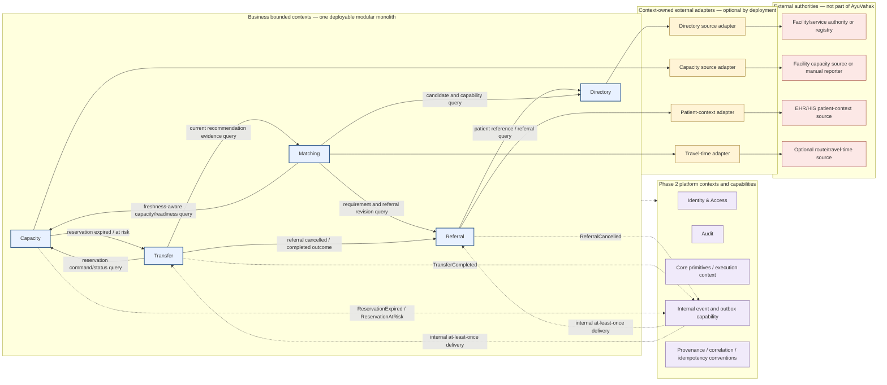
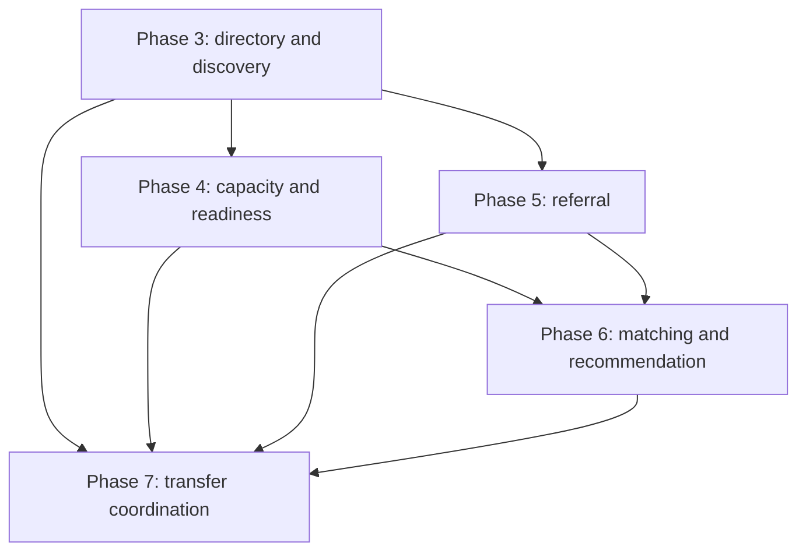

# Volume II — Core Care Coordination Architecture

**Status:** Approved design baseline for Phases 3–7. Phases 3–6 are frozen; Phase 7 implementation, acceptance, and independent review pass, with the local freeze commit pending.
**Scope:** Care Service Directory, Capacity & Operational Readiness, Referral, Destination Matching & Recommendation, and Transfer Coordination.

## Product capability

Volume II gives an AyuVahak deployment that has selected AyuVahak as its coordination-workflow owner the ability to represent care-capable destinations, collect attributed operational evidence, record a minimum-necessary referral, explain possible destinations, and coordinate a receiving request through acceptance, reservation, transfer, arrival, and handover. It does not make clinical decisions, replace an EHR/HIS or registry, operate dispatch, or store a longitudinal patient record. A deployment may omit AyuVahak when another system already owns the workflow.

The central progression is:

```text
Care need stated by a responsible care team
  → Referral and structured Care Requirement
  → Directory discovery
  → current capacity/readiness evidence
  → deterministic advisory recommendation
  → one directed Transfer Request at a time
  → separate receiving assessments and Acceptance
  → separate Capacity Reservation
  → reported Transfer progress
  → Arrival
  → Handover
  → Completion
```

Each arrow is a coordination fact or explicit command, not an implication that the prior fact guarantees the next. In particular, a listed Capability is not Capacity; Capacity evidence is not case-specific Readiness; a Recommendation is not a decision; Acceptance is not Reservation; Reservation is not admission; Arrival is not Handover; and Transfer is not Transport.

## Context model

These are business bounded contexts inside one modular monolith, not independently deployed services. Each context owns its domain language, state, rules, application boundary, persistence, external ports, and source mapping. Another context must use a published application contract or a justified internal event; it must not read private tables, repository classes, or adapters.



Arrows indicate allowed semantic communication, not synchronous deployment boundaries. Solid arrows are application queries/commands; dotted arrows are event delivery or cross-cutting platform use. The event list is intentionally small and is specified in [context contracts](volume-2-context-contracts.md). Directory and Capacity external adapters implement ports owned by those contexts. Shared interoperability support remains a platform capability, not a central integration gateway.

## Bounded-context ownership

| Context | Authoritative AyuVahak facts | Explicitly not owned |
| --- | --- | --- |
| **Directory** | Coordination projection of Organizations, Facilities, Locations, Healthcare Services, controlled CareCapability codes, and attributed facility capability assertions; local corrections and active/deactivated state. | National facility/provider identity, authoritative registry records, practitioners/credentials, live Capacity, or clinical care records. |
| **Capacity** | Capacity Observations received or manually entered for coordination, source/freshness/conflict interpretation, current evidence projection, Operational Readiness evaluation inputs, and coordination Reservations. | Physical bed ledger, staffing roster, supply inventory, clinical admission, or guaranteed real-world availability. |
| **Referral** | Referral identifier, origin, Care Requirement as asserted by responsible care personnel, minimum Patient Context reference, submitted revisions, cancellation and resolution state. | Clinical need inference, chart, diagnosis, treatment plan, destination ranking, Acceptance, Reservation, Transfer details, or Transport. |
| **Matching** | Versioned eligibility/ranking policy, the Capability Operational Requirement Policy mapping CareCapability codes to required CapacityDimensions, candidate outcomes, immutable Destination Recommendation evidence snapshots, and synchronous applicability results. | Clinical suitability decisions, Directory/Capacity truth, Referral lifecycle, selected destination decision, Acceptance, Reservation, or Transfer. |
| **Transfer** | TransferJourney, sequential Transfer Request attempts, separate attributed receiving assessments and Acceptance, recorded Reservation outcome/reference, Transfer lifecycle, Arrival, Handover, completion, cancellation and reroute history. | Referral clinical source data, Capacity's reservation ledger, physical admission, fleet/dispatch authority, vehicle tracking, or subsequent treatment. |

## The 39 design modules

The following modules define design coverage, not production packages to pre-create. Phase implementation creates only the structures needed for that phase. A module can map to one or more files/packages later; there is no requirement for one class per module.

### Phase 3 — Care Service Directory (7)

| Module | Responsibility |
| --- | --- |
| 3.1 Directory domain and ownership | Coordination projection authority, curation, source attribution, correction and deactivation. |
| 3.2 Organization / Facility / Location | Keep legal/administrative Organization, care-delivery Facility, and physical Location distinct. |
| 3.3 Healthcare Service and Care Capability | Separate organized service from stable capability assertion and governed capability code. |
| 3.4 Relationships and identifiers | Define ownership/containment links and issuer/resource-scoped external identifiers. |
| 3.5 Geographic model | Coordinate validation, spatial query semantics, missing-location behavior, and measurable distance. |
| 3.6 Directory discovery | Exact, nearby, and capability-filtered discovery without capacity/readiness claims. |
| 3.7 Directory API and acceptance | Scoped directory commands/queries, safe errors, provenance, tests, and exit gate. |

### Phase 4 — Capacity & Operational Readiness (8)

| Module | Responsibility |
| --- | --- |
| 4.1 Capacity Observation model | Source-attributed, append-oriented, time-bounded evidence. |
| 4.2 Capacity/resource types | Bounded typed dimensions and units; no generic JSON payload. |
| 4.3 Freshness/validity/confidence | Distinct observation, receipt, expiry, freshness, quality, and supersession semantics. |
| 4.4 Current-state projection | Deterministic projection and reconstruction from retained evidence. |
| 4.5 Multiple/conflicting sources | Per-dimension source priority, ties/conflicts, manual sources, and corrections. |
| 4.6 Operational Readiness | Generic evaluation over supplied CapacityDimensions; explainable READY / NOT_READY / UNKNOWN / STALE / CONFLICTED result, with no CareCapability inference. |
| 4.7 Capacity API | Scoped observation intake, current-evidence and justified history queries. |
| 4.8 Temporal/concurrency/failure suite | Verify expiry, duplicate/out-of-order inputs, conflicts, rollback, and recovery. |

### Phase 5 — Referral (7)

| Module | Responsibility |
| --- | --- |
| 5.1 Care Requirement | Structured care capability requirements and constraints asserted by a responsible source. |
| 5.2 Referral aggregate | Referral identity, origin, revisions, status, and links without owning Transfer. |
| 5.3 Patient reference | Issuer-scoped identity/reference and purpose-limited coordination context, no MPI role. |
| 5.4 Priority/constraints/metadata | Controlled urgency, timing and operational constraints without inferred triage. |
| 5.5 Referral lifecycle/API | Create, submit, amend, cancel, resolve, and query under scope and state rules. |
| 5.6 Kernel integration | Explicit Phase 2 context, functional authority, audit, provenance, event and idempotency contracts. |
| 5.7 Referral acceptance/failure suite | Verify lifecycle, authorization, privacy, retries, edits and event behavior. |

### Phase 6 — Destination Matching & Recommendation (8)

| Module | Responsibility |
| --- | --- |
| 6.1 Eligibility engine | Hard capability and operational evidence gates with explicit reasons. |
| 6.2 Geographic candidate generation | Bounded candidate search with no missing-coordinate or radius ambiguity. |
| 6.3 Travel-time abstraction | Optional context-owned estimate port; distance is never labeled travel time. |
| 6.4 Operational requirement mapping and readiness | Matching maps every required CareCapability to one or more CapacityDimensions under its immutable policy, then calls Capacity's generic freshness-aware evaluation contract; missing mapping cannot support a positive result. |
| 6.5 Deterministic ranking policy | Versioned, lexicographic, explainable ordering without arbitrary numeric weights. |
| 6.6 Explainability/evidence | Structured eligibility, evidence references, freshness, exclusions, and rationale. |
| 6.7 Recommendation snapshot/lifecycle | Immutable historical snapshot plus synchronous targeted applicability revalidation and recomputation; no event-driven invalidation assumption. |
| 6.8 Golden scenarios/policy suite | Synthetic deterministic policy, tie, missing/stale, and recomputation scenarios. |

### Phase 7 — Transfer Coordination (9)

| Module | Responsibility |
| --- | --- |
| 7.1 Transfer Request | Sequential destination-specific request attempts under a Referral journey. |
| 7.2 Receiving-side assessments | Separate Clinical Suitability and Operational Readiness Assessment facts by functional authority. |
| 7.3 Acceptance/rejection/expiry | Explicit authorized outcomes, deadlines, withdrawal and duplicate/late handling. |
| 7.4 Capacity Reservation | Capacity-owned, idempotent hold command and conflict/risk outcomes. |
| 7.5 Destination selection/rerouting | Human choice among eligible evidence-backed candidates; preserve attempts and reassess. |
| 7.6 Transfer lifecycle | Reported movement and coordination state, independent of Transport dispatch. |
| 7.7 Arrival/handover/completion | Separate real-world arrival report, acknowledged clinical handover, and closure. |
| 7.8 Coordination API/query model | Scoped commands and bounded status/history views without leaking other contexts' storage. |
| 7.9 Full workflow/race/recovery suite | End-to-end happy/failure paths, retries, concurrency and recovery. |

## Allowed collaboration and persistence boundaries

- Contexts share one PostgreSQL deployment but own separate logical schemas once their first real state is implemented: `directory` (Phase 3), `capacity` (Phase 4), `referral` (Phase 5), `matching` (Phase 6), and `transfer` (Phase 7). A schema and migrations are created only when its owning phase begins; no empty future schema is pre-created. Versioned Flyway migrations remain owner-local.
- A context may keep external/internal identifiers as typed references. There are no cross-context foreign keys, direct joins, or direct SQL/table/repository access.
- Synchronous queries and commands use the provider context's application contract. They return explicit unknown, stale, conflict, unavailable, or rejected outcomes; they never fabricate a positive fact after timeout.
- The Phase 2 event/outbox capability is used for committed facts with a real consumer and, exceptionally, a same-Volume future consumer whose complete contract is already frozen. Such a declared event is durably deferred without attempts or a consumer receipt while its consumer is absent; later consumer activation does not automatically replay it. This is not a workflow engine or external integration publisher.
- No distributed transaction is implied across context boundaries. A caller records an explicit pending/unknown outcome, uses an idempotent operation identifier, then retries or queries owner state.
- Aggregate transaction boundaries remain inside the owning context. For example, Capacity makes the reservation decision atomically within Capacity; Transfer records the response in its own transaction.

## Functional authority and audit boundaries

These authority names are policy functions, not global job titles. Phase 2 owns generic scoped grant evaluation. Each deployment maps real roles, teams or governed processes to the functions and may grant one actor more than one function only through explicit grants. Missing, inactive, ambiguous or out-of-scope grants deny. Scope is exact to the action: `PLATFORM`, `ORGANIZATION(orgRef)`, or `FACILITY(orgRef, facilityRef)` under the Phase 2 contract.

For Matching, the human requester is authorized under the `RecommendationRequest` authority at the exact Referral origin. Owner reads execute under a separately configured machine identity, with owner-owned `ReferralRead`, deployment-bounded `DirectoryRead`, and candidate-Facility-scoped `CapacityEvidenceReview` grants. No requester grant is forwarded. Each owner audits its service read; Matching records the human command actor. See ADR 0022 and the Volume II context contracts.

| Context / function | Typical permitted scope and operations |
| --- | --- |
| Directory reader / Directory curator | Read is limited to participating/coordinating scope; curation is owned by the Facility/Organization or explicitly delegated directory authority. `CapabilityVocabularyAdministration` is platform-scoped. |
| Capacity reader / Capacity reporter / Capacity policy administrator | Queries and reports are destination-facility scoped. Policy administration is limited to the deployment authority that governs the dimension/source policy. Reservation administration is a Capacity owner operation authorized for the destination's configured reservation function. |
| Referral originator / Referral reviewer | Create/submit/amend/cancel is scoped to the origin Facility/Organization; a receiving participant sees only an explicitly shared active request and minimum Referral basis. Resolution is scoped to the origin or the explicitly authorized Transfer outcome consumer. |
| Recommendation requester / viewer | Evaluation and view are scoped to the Referral's origin organization/facility and authorized case participants; no global candidate or case feed. |
| Clinical Suitability Authority / Operational Readiness Authority / Acceptance Authority | Each function is separately scoped to the destination facility. A positive assessment by one function cannot substitute for another. |
| Transfer coordinator / Transfer reporter | Request creation is origin-scoped; assessment/Acceptance is destination-scoped; Arrival/Handover reports are destination or designated factual-source scoped. Cross-organization coordinators require explicit grants for both data views/actions. |

Mutation audit is required for Directory curation/capability changes, manual Capacity observations/corrections/policy changes/reservation outcomes, Referral submit/amend/cancel/resolve, safety-relevant Recommendation execution/disposition, Transfer requests/assessments/Acceptance/rejection/withdrawal, Transfer state changes, Arrival/Handover/completion and sensitive access as deployment policy defines. Required mutation audit is atomic with owner state per ADR 0012. A harmless bounded Directory browse is not automatically sensitive; patient-reference and restricted case reads require the policy's durable read audit. Audit records contain actor/service, validated organization/facility, action, target, timestamp, outcome, purpose where applicable, and correlation—not clinical payload.

## Data and clinical boundary

Referral retains an issuer-scoped external patient reference and only the coordination fields needed by an active case. The initial Volume II design does not require patient name, birth date, address, national ID, diagnosis, medication, narrative note, clinical attachments, Patient/Encounter/Observation resources, or an IPS payload. A selected receiving participant may retrieve the opaque source reference through a purpose-bound Referral view after a Transfer Request exists; Transfer stores only its Referral reference. A deployment must document a concrete operational/legal need before adding any additional patient field. Matching receives requirement values and non-identifying operational evidence; recommendation snapshots do not copy patient context. Audit targets the AyuVahak Referral/Transfer identifier rather than the PatientReference. Events and ordinary logs carry no patient identifiers or case payloads.

Categories are: **reference only** for patient and partner identity; **bounded coordination state** for Referral and Transfer; **append-oriented operational evidence** for Capacity; **immutable evidence snapshot** for Matching; **aggregate/de-identified** only for any later Analytics phase. Legal retention periods remain deployment/jurisdiction decisions; records are not retained indefinitely by default.

## Phase order and readiness



The execution sequence remains 3→4→5→6→7. The graph shows semantic dependency, not permission to skip a prior phase acceptance gate. Each phase is frozen after its own review before the next phase begins. Phase-specific acceptance gates and test seams are in the five linked specifications.

## Negative scope

Volume II design does not include HAPI/FHIR resources or adapters, IPS, mCSD connector behavior, DHIS2, OpenHIE/OpenHIM mediation, LMIS, EMS dispatch, external routing provider implementation, Notifications, Analytics business logic, user interface, AI/LLM, broker, Redis, distributed services, Kubernetes, production cloud topology, concrete SQL/table definitions, actual Java packages/classes, controller method signatures, or implementation tickets. Standards remain future adapter concerns under the frozen R4-first interoperability architecture.

## Related documents

- [Context contracts](volume-2-context-contracts.md)
- [State machines](volume-2-state-machines.md)
- [Capacity and readiness policy v1](capacity-readiness-policy-v1.md)
- [Matching policy v1](matching-policy-v1.md)
- [Data ownership](data-ownership.md)
- [Bounded contexts](bounded-contexts.md)
- [Phase specifications](../specs/)
