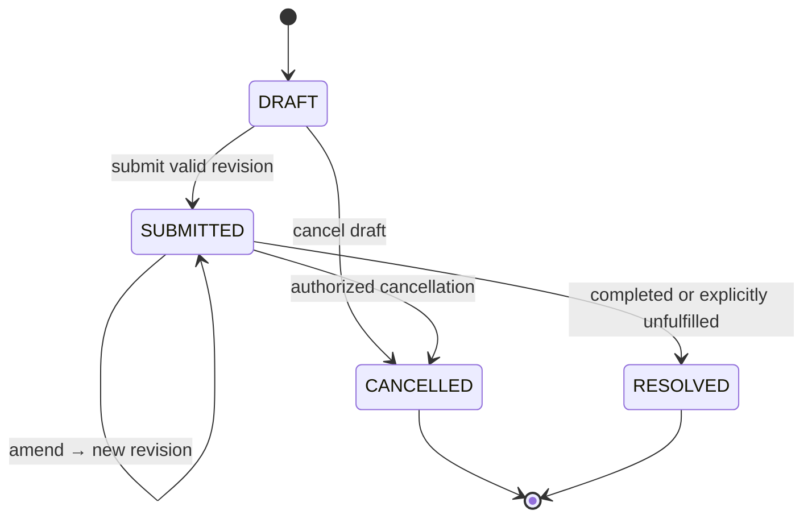
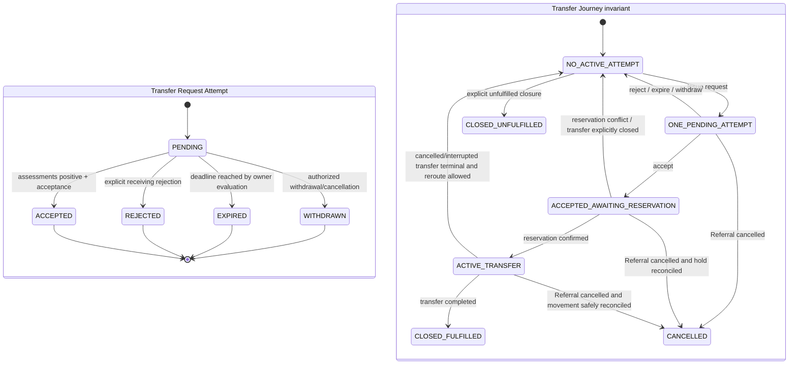
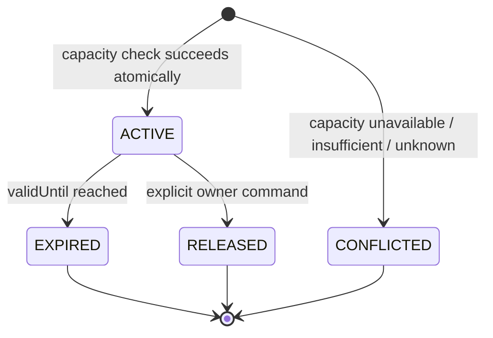

# Volume II State Machines and Temporal Semantics

These state machines describe domain facts and valid transitions; they do not prescribe a workflow engine. Every transition is an owner-context command, actor/source-attributed and audited under Phase 2. Invalid transitions return a stable domain error and do not change state. Duplicate command retry replays its prior outcome; duplicate event delivery cannot repeat the effect.

## Referral

- Each submit creates an immutable numbered revision containing the Care Requirement, origin and permitted patient reference. Amendment creates a new revision; prior recommendation/transfer evidence remains tied to the revision it used.
- A Referral with a pending Transfer Request cannot be amended or cancelled by a silent overwrite. Cancellation is an explicit command/event and Transfer reconciles its own request/hold/movement state.
- `RESOLVED` means the coordination request is completed or explicitly closed unfulfilled with an outcome. It is not a clinical outcome or discharge status.
- A Transfer completion event requests idempotent Referral resolution; consumer failure leaves the Referral visibly submitted until retried/reconciled.

## Transfer Request attempt and journey

- One TransferJourney belongs to one Referral and preserves ordered attempt history. It permits at most one pending Transfer Request and at most one nonterminal Transfer. Requests target one Facility and bind to a specific submitted Referral revision and recommendation snapshot.
- Before each Transfer Request, Transfer obtains a synchronous Matching applicability result for the exact snapshot, candidate and Referral revision. Only `APPLICABLE` permits the request; `NOT_APPLICABLE` and `INDETERMINATE` block it. Applicability is not stored state on the historical snapshot and does not depend on invalidation events.
- The human/authorized coordinator chooses among candidates; position 1 is not automatic selection. Initial policy permits a request only to a candidate that is currently eligible with required fresh evidence. An ineligible candidate requires a separately governed later override policy, not an unlogged bypass.
- Clinical Suitability, Operational Readiness, and Acceptance are distinct outcomes. One locally authorized person may perform more than one function only where deployment policy grants each function separately. A positive assessment is not Acceptance.
- A late Acceptance after expiry/withdrawal/rejection is rejected as a stale transition. An exact retry of a previously committed Acceptance is replayed idempotently.
- Reservation conflict does not undo the recorded Acceptance. It leaves the journey accepted-but-unreserved and not ready for departure until an explicit recovery/reroute decision closes or proceeds under policy.

## Capacity Reservation

`AT_RISK` is a risk flag on an otherwise active reservation, not a claim that a reservation was released. It is raised when a later observation makes held capacity unsupported; a later recovery observation may clear the flag only under the same versioned capacity policy and an auditable Capacity command. It never silently changes an accepted transfer into a new reservation.

- Capacity alone owns reservation creation, release, expiry, risk, and current held amount. A reservation is a coordination hold for a typed dimension/unit/time interval; it is not physical bed assignment, admission, or an external system guarantee.
- An insufficient, stale, unknown, conflicted or unavailable capacity projection cannot create a positive hold. Repeating the same stable operation ID/fingerprint returns the same outcome. Same key/different request conflicts.
- Capacity records reservation success atomically with any event intent required by the canonical event catalog. Phase 7 defines no event for reservation creation or reconciliation, so this command creates no event intent. A reservation-vs-capacity update is serialized in Capacity's database transaction; at most one request can consume the last available coordination quantity.

## Transfer

```mermaid
stateDiagram-v2
  [*] --> AWAITING_RESERVATION: Acceptance recorded
  AWAITING_RESERVATION --> READY: reservation confirmed
  AWAITING_RESERVATION --> ARRIVED: late report; patient arrived before workflow caught up
  AWAITING_RESERVATION --> CANCELLATION_PENDING_RELEASE: explicit pre-departure cancellation; reservation outcome must reconcile
  AWAITING_RESERVATION --> COORDINATION_EXCEPTION: reservation expired/conflicted/at risk
  READY --> IN_TRANSIT: departure reported
  READY --> ARRIVED: arrival reported before digital departure update
  READY --> COORDINATION_EXCEPTION: active reservation becomes at risk
  READY --> CANCELLATION_PENDING_RELEASE: explicit pre-departure cancellation
  IN_TRANSIT --> ARRIVED: arrival reported
  IN_TRANSIT --> INTERRUPTED: journey reported aborted/exception
  INTERRUPTED --> IN_TRANSIT: authorized resumption reported
  INTERRUPTED --> CANCELLED: journey definitively abandoned and hold reconciled
  ARRIVED --> HANDED_OVER: receiving handover acknowledged
  HANDED_OVER --> COMPLETED: coordination closure confirmed
  COORDINATION_EXCEPTION --> AWAITING_RESERVATION: same accepted journey retries hold under policy
  COORDINATION_EXCEPTION --> ARRIVED: late factual report of arrival
  COORDINATION_EXCEPTION --> CANCELLATION_PENDING_RELEASE: journey abandoned; release must reconcile
  CANCELLATION_PENDING_RELEASE --> CANCELLED: Capacity confirms released or expired
  COMPLETED --> [*]
  CANCELLED --> [*]
```

- `READY` means a current Capacity coordination hold was confirmed; it is not an admission or guarantee against a later risk event.
- `ARRIVED` may be recorded from `READY` when the physical event occurred before a digital departure update arrived. Store `occurredAt` and `recordedAt`; do not fabricate an `IN_TRANSIT` event. Audit the late report and preserve chronology.
- `HANDED_OVER` requires a distinct receiving acknowledgement. `COMPLETED` closes the coordination workflow; it does not record clinical disposition.
- Arrival/handover/cancellation reports are idempotent commands. Conflicting facts require an explicit correction/supersession command and provenance; do not edit history silently.
- This phase does not own dispatch assignment or live vehicle location. `IN_TRANSIT` is a reported coordination state only.

## Temporal rules

| Time | Meaning | Rule |
| --- | --- | --- |
| `observedAt` | When a source says a capacity fact was true. | May differ from receipt time; future-skew beyond configured tolerance is quarantined/invalid for current evaluation and remains attributable for review. |
| `receivedAt` | When AyuVahak accepted the message. | Server-controlled, UTC; never used alone to make an older fact current. |
| `validUntil` | End of source-declared or policy-derived validity. | Exclusive boundary: at or after the instant it is expired. Missing policy cannot silently grant indefinite validity. |
| `generatedAt` | When a recommendation snapshot was evaluated. | Server-controlled; exact evidence and policy versions are retained. |
| `applicableUntil` | Earliest decision deadline from policy and material evidence expiry. | At or after this instant, not usable for a new Transfer Request without reevaluation. |
| `requestExpiresAt` | Deadline after which a pending request can no longer accept. | UTC instant set from an explicit deployment policy; expiry is a state transition by an owner command/job and is retry-safe. |
| `reservationExpiresAt` | End of an active hold. | Capacity owner evaluates expiry and emits one durable fact; a Transfer cannot assume the hold persists. |
| `occurredAt` / `recordedAt` | Real-world event time / time AyuVahak recorded it. | Both retained; wall-clock order does not replace aggregate sequence for causal ordering. |

`applicableUntil` is a necessary age/evidence bound, not a sufficient proof that a snapshot is currently applicable. Transfer must use the synchronous Matching revalidation contract to check material current owner facts before creating a request. Historical snapshots remain immutable. All comparisons use UTC instants and an injectable time source in implementation tests. Clock skew is bounded by a deployment-validated tolerance; beyond tolerance, evidence is marked invalid/unknown for a current decision, never clamped to look fresh.
