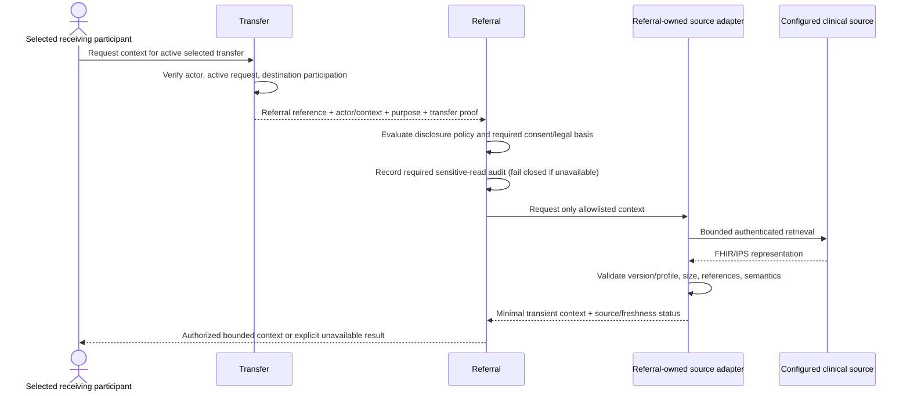

# Volume III context contracts

**Status:** Volume III design is frozen. Phases 8 and 9 implementation are frozen; Phase 10 is in progress. The contracts below remain the normative owner-facing boundaries, not Java signatures, wire endpoints, or schemas; phase acceptance records capture implementation evidence.

## Contract principles

- Caller asks an owner to perform or disclose something in the owner’s vocabulary.
- An adapter returns a typed outcome that distinguishes unavailable, rejected, stale, incomplete, invalid, and successful results. Missing evidence is never coerced to zero, false, current, or success.
- Every request carries actor or machine identity, organization/facility execution context where applicable, purpose, correlation, and an idempotency/operation identity where a repeat can cause effects.
- Owner context performs its own grant, scope, policy, and state validation. A transport client certificate or partner OAuth scope does not bypass local authorization.
- Owner state plus required audit/outbox record is committed using the frozen Kernel contracts. External I/O is never part of a fictitious distributed transaction.
- External identifiers are namespaced by source system and resource kind; they are references, not internal identities. A text collision does not imply equivalence.

## Owner contracts

| Boundary | Caller → owner | Purpose and minimum input | Result / errors | Persistence, privacy, and timing |
| --- | --- | --- | --- | --- |
| Directory source import | External mCSD Data Source → AyuVahak mCSD Directory / Directory-owned adapter | Source identity, source version/identifier, mapped organization/facility/location/service/capability facts, source time, received time, mapper/profile version, completeness marker | Accepted, unchanged, conflict/disputed, rejected, stale, or reconciliation-required. The adapter cannot write Directory tables. | Optional ITI-130 direction is external source → AyuVahak only. Directory owns its coordination projection and namespaced source associations. Store bounded mapped facts and provenance. No patient data. Usually asynchronous feed/reconciliation. |
| Directory source discovery/update | AyuVahak mCSD Query Client or Update Client → configured external mCSD Directory | ITI-90 discovery query or optional ITI-91 request for changes since a prior refresh; bounded page/cursor and configured profile | Mapped candidates/updates plus per-record provenance/freshness, partial/incomplete, or unavailable | ITI-90 and optional ITI-91 are read paths from AyuVahak to the external Directory. No create/update/delete write-back to an external master. Endpoint comes from trusted config only. mCSD facts do not state operational capacity. |
| Capacity observation import | Configured source adapter → Capacity | Source system, resource identity/version, explicit measurement semantics, dimension/value/unit, observed/received times, source status, mapper version | Accepted evidence, rejected, stale, conflicting, unsupported, or unavailable | Capacity remains owner of operational evidence/readiness evaluation. A schedule/slot is not a bed or readiness fact absent explicit Capacity policy. No provider payload blob. |
| Referral clinical-context request | Selected-recipient application → Transfer participation check → Referral disclosure policy → Referral-owned source port | Referral opaque reference, authenticated actor, selected transfer/request and recipient relationship, declared purpose, policy/consent/legal-basis references if configured, correlation | Denied, unavailable, no source, incomplete/unsupported context, or bounded context response with provenance and freshness | Referral retains its existing PatientReference. Full FHIR/IPS content is transient; access is audited before disclosure where required. No context is returned if policy or required audit is unavailable. Synchronous read with bounded timeout; never changes Transfer lifecycle. |
| Outbound owner exchange | Owning context → shared exchange capability via owner adapter | Owner operation ID, partner ID, allowed operation/profile, minimal mapped payload, correlation, source aggregate version | Delivered, retryable failure, permanent rejection, unknown outcome, revoked, or reconciliation required | Owner retains business intent and reconciliation status; shared capability transports only. Payload retention is avoided; if retry requires a payload, store encrypted/minimized data under owner access and bounded retention. Asynchronous by default. |
| Inbound partner message | Authenticated partner → partner boundary → configured owner adapter → owner command | Partner identity, operation/profile, signed/authenticated envelope, source event/version, external idempotency/reference, correlation | Accepted, duplicate, rejected, conflict, unauthorized, unsupported, or unavailable | Inbound boundary authenticates partner and checks operation scope; owner validates domain semantics and current state. Durable owner state/audit/dedup where applicable; no direct tables. |
| Transport request eligibility | Transport service identity → Transfer owner query `CheckTransportRequestEligibility` | Transfer reference, requested origin/destination references, operation identity, correlation | `ELIGIBLE`, `INELIGIBLE` with bounded reason, or `UNAVAILABLE/AMBIGUOUS` | Transfer returns only whether the active Transfer is in the permitted pre-departure phase, requires transport, has a current accepted destination and required confirmed reservation, and the supplied references match its own state. It returns no clinical context. Transport fails closed on unavailable or ambiguous results. |
| Transport request | Transfer → Transport | Transfer reference, origin/destination references, requested pickup window/priority, only necessary operational constraints, request operation ID, initiating actor attribution | Transport request reference and state, or no-provider/manual-needed/unfulfilled result | Transfer authorizes the human command; Transport independently authorizes its narrowly scoped service identity, calls `CheckTransportRequestEligibility`, and creates the owner-local request only for an eligible current relationship. Transport owns request and attempt history. No PatientReference or diagnosis. Manual mode is supported. |
| Transport cancellation | Transfer application with its own authorized actor decision, or an authorized Transport actor → Transport | Transport request reference, reason, stable cancellation operation ID, correlation and actor/execution context | Cancelled before movement, still active, outcome unknown, cannot cancel after movement, or reconciliation required | Both owners authorize their effects: Transfer validates the human's Transfer command; Transport validates a narrowly scoped Transfer service grant at the deployment-declared origin scope or direct `TransportCancellationAuthority`. The service grant is limited to the named operations and does not inherit the human's grants. Transport owns a durable cancellation operation and provider reconciliation. A pending/unknown outcome blocks replacement. |
| Transport cancellation reconciliation | Transport → Transfer through `GetTransportCancellationOutcome` and `transport.cancellation-resolved.v1` | Linked Transfer/Transport references and cancellation operation reference | Pending/unknown or a resolved cancellation outcome with source/received times | Transfer can query only the outcome for its linked request using its scoped service identity; terminal outcome event is minimal and deduplicated. Transfer retains its own state and cannot infer successful cancellation from an HTTP acknowledgement alone. |
| Movement evidence | Transport → Transfer owner contract/event | Transfer reference, Transport request reference, evidence kind, source and observed/received times, source sequence/version if any, actor/service, correlation/causation | Transfer records a validated departure/arrival fact, records a coordination exception, or rejects/defers contradictory/duplicate/out-of-order evidence | Transfer owns its own movement lifecycle and audit; Transport owns source observation. No shared persistence. Minimal event excludes patient context, clinical payload, precise location history. Asynchronous event delivery at least once; Transfer deduplicates and validates. |
| Destination change eligibility | Transport service identity → Transfer owner query `CheckTransportDestinationChangeEligibility` | Transfer reference, Transport request reference, current/proposed destination references, stable operation identity, correlation | `ELIGIBLE`, `INELIGIBLE` with bounded reason, or `UNAVAILABLE/AMBIGUOUS` | Transfer confirms that a specifically authorized reroute intent is pending, its current and proposed destination match Transfer-owned state, the required fresh Matching/receiving/Capacity checks have succeeded, and no conflicting lifecycle operation is active. Returns no patient context. Transport fails closed if unavailable or ambiguous. |
| Destination change coordination | Transfer → Matching, receiving authorities, Capacity, then Transport | Current Transfer/Journey and movement evidence, proposed new destination, reason, stable operation identity, required fresh recommendation/acceptance/readiness/reservation evidence | Accepted by the provider/manual transport authority, rejected, unknown, or reconciliation required | Transfer owns reroute authority, intent, active destination, attempt history, and required new Capacity reservation. For post-movement reroute, Transfer first durably records the authorized pending intent and confirms the new destination is suitable, accepted, ready, and reserved under existing owner contracts. It then commands Transport, which independently checks its scoped service grant and `CheckTransportDestinationChangeEligibility`. The provider/crew acknowledgement is not itself a Transfer destination change. Transfer applies the new active destination only after consuming a correlated accepted outcome and revalidating its own prerequisites. Unknown outcomes keep the old destination fact, retain both reservation outcomes for reconciliation, and block another change; no generic patch is allowed. |
| Transport destination-change operation | Transport owns provider/manual request and outcome; Transfer owns destination intent and final active destination | A Transfer-owned operation reference, linked Transfer/Transport references, old/new destination references, reason category, provider/manual outcome, source/time, correlation | Durable owner-scoped operation with stable identity; accepted, rejected, unknown, or reconciliation-required result | No patient context, diagnosis, or raw provider payload. Same operation identity is used for recovery. Transport publishes `transport.destination-change-resolved.v1` only for a concrete accepted/rejected outcome; Transfer deduplicates and validates linkage/current pending intent before applying its own state. No shared exchange ledger. |
| Reroute reservation release | Transfer → Capacity through `ReleaseCoordinationReservation` and `GetReservationOutcome` | Old or proposed Capacity reservation reference, linked Transfer reference, release operation ID/fingerprint, scope, correlation | `RELEASED`, `EXPIRED`, conflict, unknown, or unavailable | Capacity alone changes reservation state. After an accepted reroute, Transfer first commits the new active destination, then requests release of the old hold; on provider rejection it releases the proposed hold. Each release has its own stable Capacity operation identity. Unknown is queried/retried with the same identity; Transfer does not claim release. A successful reroute remains active while old-hold cleanup is pending, but the pending cleanup is visible and blocks another reroute. No shared ledger or direct Capacity persistence access. |

## Exchange infrastructure contract

The shared platform capability accepts only an already-authorized operation descriptor and partner configuration reference. It enforces transport-level policy (TLS, configured authentication mechanism, safe URL resolution, limits, timeouts, redirect behavior, correlation, and redacted telemetry). It does not decide a business retry, map a profile into domain meaning, choose a receiving facility, approve disclosure, own source IDs, or mark a referral/transfer complete.

Partner configuration is administrative control-plane data, not ordinary caller input. It contains a stable partner key, partner organization associations, allowed owner contexts/operation directions, protocol/profile versions, approved endpoint origins and path policy, auth method, secret references, trust state, size/page/resource/time limits, retry class, and configuration version. Credential material resides in an operator-managed secret provider or deployment injection, not ordinary application/business rows. Configuration changes are audited and become effective as a versioned snapshot. Deactivation/revocation blocks new calls immediately and queued work before the next attempt; no cached credential can outlive its configured revocation behavior.

## Authorization and audit context

For external exchange, audit ties together the initiating human/service identity, AyuVahak organization/facility context, partner, operation class, owner reference, policy/config version, correlation, timestamp, and outcome. Sensitive audit records exclude PatientReference, tokens, raw FHIR, and request/response bodies. Partner authentication identifies the peer; it does not authorize every operation or organization. The relevant owner grant and current execution context remain decisive.

For clinical context disclosure, the sequence is:

No patient payload enters Transfer, Matching, Capacity, Transport, generic audit, normal logs, metrics, or traces. Failure of the clinical source returns unavailable/partial context; it does not erase an already committed Transfer acceptance unless the specific future workflow explicitly marks that context a hard prerequisite.
