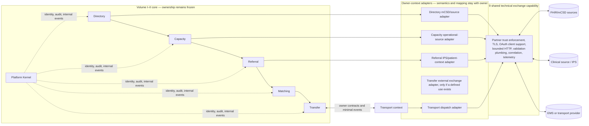

# Volume III architecture: interoperability, secure exchange, and transport

**Status:** Volume III design and Phases 8–10 implementation are frozen. Integrated acceptance evidence is recorded in [Phase 10 acceptance](../reviews/phase-10-acceptance.md) and [Volume III acceptance](../reviews/volume-3-acceptance.md).
**Scope:** attaches standards adapters, external exchange controls, and transport coordination to the frozen Volume I–II modular monolith. This document records the approved architecture; implementation scope was separately authorized and gated by phase.

## Architecture intent

Volume III adds three capabilities around the existing coordination core:

1. **Phase 8 — Healthcare Standards & Interoperability:** standards-aware, context-owned mappings at existing owner ports.
2. **Phase 9 — Secure External Health-System Exchange:** shared technical safeguards and partner exchange mechanics used by those owner adapters.
3. **Phase 10 — Emergency Transport / EMS Coordination:** a Transport bounded context that coordinates movement separately from Transfer.

The frozen authority chain remains:

```text
Directory → Capacity → Referral → Matching → Transfer
                         Platform Kernel
                         (Identity, grants, audit,
                          internal events/outbox, idempotency)
```

Volume III attaches without transferring those ownerships:



The shared exchange capability is not a business bounded context, universal gateway, or semantic integration service. It cannot choose what a resource means, issue domain commands on its own, own another context’s identifiers, decide retries’ business meaning, or write owner tables. If a context has no justified exchange use, it has no adapter merely for symmetry.

## Boundary rules

- An owner context defines the external port in terms of its own need. Its adapter maps external representations into the existing owner application contract and owns source-specific reconciliation.
- FHIR classes, XML/JSON parsers, SMART client details, external DTOs, and provider-specific codes stay outside domain packages. No FHIR-driven aggregate redesign.
- The external source remains authoritative for its records. AyuVahak may retain a bounded coordination projection, external identifier association, or provenance metadata only where the owning context needs it and its policy permits it.
- No external caller, adapter, exchange service, or transport partner writes another context’s private persistence. Owner commands/contracts and internal events are the only cross-context path.
- External delivery, an HTTP response, valid FHIR, an ETA, or a dispatch assignment never implies a business state transition unless an owner context validates and records the corresponding fact.
- Optional integration failure yields explicit unknown/unavailable/needs-reconciliation outcomes. It does not fabricate a positive capacity or erase an already committed local fact.
- Deployment policy determines which partners, protocols, scopes, retention periods, jurisdictions, and network ranges are configured. A deployment may omit any external system.
- No product path may require a public healthcare endpoint for development or acceptance testing.

## Capability ownership by phase

| Capability | Semantic owner | Shared technical support | Phase |
| --- | --- | --- | --- |
| mCSD organization/facility/service projection | Directory | bounded authenticated HTTP, payload limits, common correlation | 8 |
| Operational source-to-capacity evidence | Capacity | transport security and common client safeguards | 8, only named source profile |
| Patient-context/IPS retrieval and disclosure | Referral, with Transfer participant check | FHIR parser/validator plumbing, TLS/token support | 8/9, gated by disclosure policy |
| Partner trust profile and exchange transport | No business owner; platform capability enforces configuration | TLS, authentication mechanism support, egress constraints, safe metrics | 9 |
| Dispatch request/assignment/movement facts | Transport | Phase 9 exchange capability when integrated; manual adapter remains valid | 10 |
| Transfer acceptance, reservation, arrival, handover, completion | Transfer | No transfer to Phase 9 or Transport | Existing Volume II |

## Privacy and trust posture

An external system is independently administered and is not trusted merely because it is on a partner list or emits standards-conformant data. Trust is scoped to configured partner identity, operation, direction, profile, organization association, and allowed data. Each inbound payload is bounded, authenticated, authorized, structurally/profile validated, semantically checked by its owner, and attributed to source and receipt time.

PatientReference remains a source-scoped opaque Referral reference. It is not copied to Matching, Transfer, Transport, generic audit, ordinary logs, events, metrics, or traces. A receiving user’s organization membership does not itself authorize clinical disclosure. Transfer proves selected-recipient participation; Referral independently evaluates configured purpose and disclosure policy, records required access audit, then retrieves only the approved context. Missing policy or required audit fails closed.

The full IPS document is transient input/output by default. Only explicitly allowlisted, purpose-required values may be rendered for an authorized recipient in the active transfer flow. No full Bundle, Composition, Patient resource, attachment, or longitudinal clinical history is retained by AyuVahak. A deployment’s legal basis, consent handling, and retention rules are not universalized by this architecture.

## Failure model

Every outside dependency can be absent, delayed, duplicated, stale, contradictory, revoked, malformed, compromised, or partially successful. Owner state is protected from external failure. Synchronous dependencies are limited to operations whose contract requires fresh evidence; ancillary context retrieval and outbound notification are not implicit preconditions to a committed Transfer fact. An unknown remote outcome is recorded as unknown and reconciled through the same operation identity or a read/status contract; it is not blindly retried when the remote side effect may have occurred.

The detailed contracts, lifecycle rules, threat cases, and acceptance requirements are in [context contracts](volume-3-context-contracts.md), [state machines](volume-3-state-machines.md), [threat model](volume-3-threat-model.md), and the [Phase 8](../specs/phase-8-healthcare-standards-interoperability-spec.md), [Phase 9](../specs/phase-9-secure-external-exchange-spec.md), and [Phase 10](../specs/phase-10-emergency-transport-coordination-spec.md) specifications.
