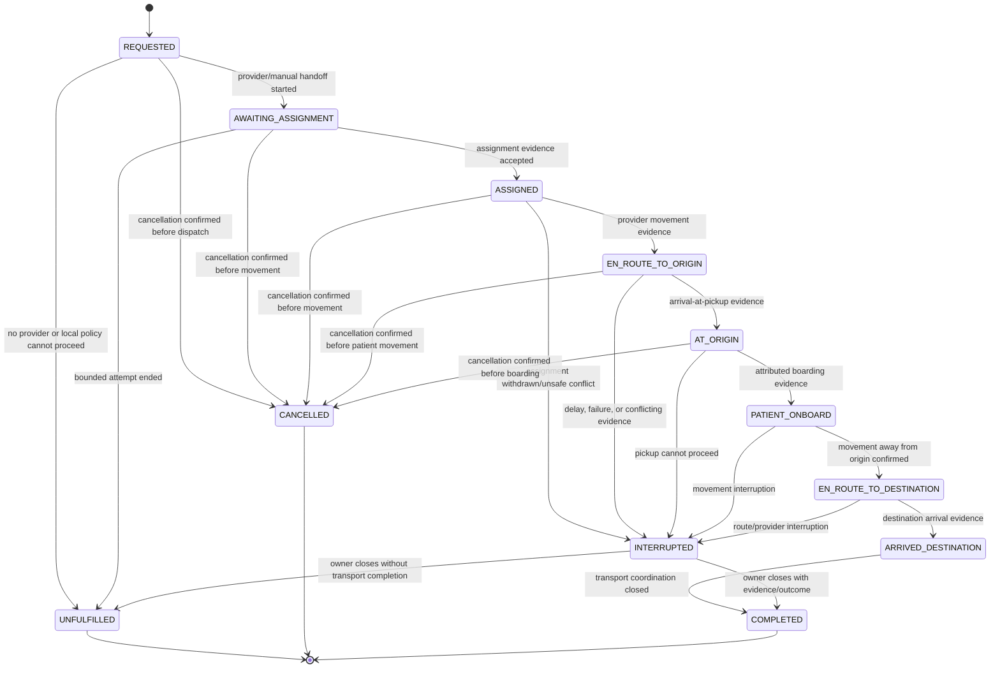

# Volume III state machines

**Status:** Volume III design is frozen. Phases 8 and 9 implementation are frozen; Phase 10 is in progress. This document remains the normative state-machine and ownership reference; acceptance evidence is in the corresponding phase and Volume III review records.

The models are conceptual owner state, not provider-specific status mirrors. Every observation records source/actor, occurred time, received/recorded time, correlation, and sequence/version when supplied. Conflicting or out-of-order evidence is retained and reconciled; it does not rewrite prior facts.

## Owner-scoped external exchange operation

Each owner context owns its exchange intent, stable operation identity, business retry meaning, and reconciliation outcome. There is no global exchange-operation ledger. Shared Phase 9 capability owns only bounded transport-attempt mechanics and technical attempt observations; it returns outcomes to the owner.

| State | Meaning | Allowed next states | Recovery |
| --- | --- | --- | --- |
| `READY` | Owner has committed a bounded exchange intent and stable operation identity. | `IN_FLIGHT`, `CANCELLED`, `REVOKED` | Dispatch from owner-managed work after partner configuration and authorization recheck. |
| `IN_FLIGHT` | One bounded network attempt is active. | `DELIVERED`, `RETRY_WAIT`, `REJECTED`, `OUTCOME_UNKNOWN`, `REVOKED` | On process loss, reclaim only when the owner's idempotency/recovery contract makes retry safe. |
| `RETRY_WAIT` | Classified transient error; retry is allowed and bounded. | `IN_FLIGHT`, `EXHAUSTED`, `REVOKED`, `CANCELLED` | Recheck partner trust/configuration and owner policy before each attempt. |
| `OUTCOME_UNKNOWN` | A side effect may have occurred but no trustworthy response was recorded. | `DELIVERED`, `RECONCILIATION_REQUIRED`, `REVOKED` | Retry only with partner idempotency/status-query semantics; otherwise reconcile manually or by an authoritative read. |
| `DELIVERED` | Partner acknowledged the operation under its configured contract. | terminal | Delivery evidence only; never business acceptance/completion. |
| `REJECTED` | Permanent response or local policy/profile/authorization rejection. | terminal or a new versioned owner operation | Correct configuration/payload and issue a new owner operation. Do not retry unchanged. |
| `EXHAUSTED` | Bounded transient retries ended. | `RECONCILIATION_REQUIRED`, `REVOKED` | Owner-visible, attributable resolution; no infinite retry. |
| `RECONCILIATION_REQUIRED` | The outcome needs explicit resolution. | terminal or new owner operation | Owner decides next business action. Never fabricate remote success/failure. |
| `CANCELLED` / `REVOKED` | Work was stopped before a new side effect or partner trust was disabled. | terminal | Retain minimal owner lifecycle/audit evidence; do not send again. |

Owner state and required internal event/outbox intent are atomic under the frozen Volume I/II contract. External network I/O is not part of that transaction. Delivery is at least once where safe; no exactly-once claim is made. Per-owner aggregate sequence prevents a later event from being treated as published ahead of an earlier unpublished event where the frozen contract requires order. External-operation idempotency remains distinct from owner command idempotency and internal consumer deduplication.

## Partner trust lifecycle

```text
DRAFT → VALIDATED → ACTIVE → SUSPENDED → ACTIVE (new config version)
                      │             └→ REVOKED
                      └→ REVOKED
```

- Only an authorized operator can validate, activate, suspend, or revoke partner configuration; each action is audited with its configuration version.
- Activation requires a named partner owner, scoped organization association, approved origins/protocols/profiles/directions, authentication material references, TLS policy, and resource/time limits.
- `SUSPENDED` stops new work and holds queued work. `REVOKED` invalidates cached credentials and prevents automatic retries; unknown remote outcomes remain owner reconciliation records.
- Re-activation is a new reviewed configuration version, not a mutation that silently revives old queued work.

## Transport request lifecycle

Transport's movement/request lifecycle and cancellation lifecycle are separate. A durable cancellation operation can remain pending while the request's attributed assignment or movement observations continue to arrive. A late assignment never clears cancellation intent. Until cancellation is confirmed before movement, Transfer cannot replace the request; if movement has begun, any destination change follows the explicit post-movement safety workflow.



No cancellation-pending state is used as the transport request's operational status. The cancellation command has its own stable operation ID and state:

| Cancellation state | Meaning | Allowed next state | Recovery and effect |
| --- | --- | --- | --- |
| `PENDING` | Transport durably accepted the cancellation operation; provider/manual outcome is not yet confirmed. | `CANCELLED_BEFORE_MOVEMENT`, `CANCEL_REJECTED_ACTIVE`, `MOVEMENT_ALREADY_STARTED`, `OUTCOME_UNKNOWN`, `RECONCILIATION_REQUIRED` | Keep the same operation identity. A late assignment is appended as evidence; repeat cancellation only under the provider's safe idempotency contract. |
| `OUTCOME_UNKNOWN` | Cancellation may have taken effect but no trustworthy response was recorded. | `CANCELLED_BEFORE_MOVEMENT`, `CANCEL_REJECTED_ACTIVE`, `MOVEMENT_ALREADY_STARTED`, `RECONCILIATION_REQUIRED` | Use only provider idempotency/status query or operator reconciliation. Replacement remains blocked. |
| `RECONCILIATION_REQUIRED` | Conflicting, missing, or non-queryable evidence prevents a safe automated conclusion. | `CANCELLED_BEFORE_MOVEMENT`, `CANCEL_REJECTED_ACTIVE`, `MOVEMENT_ALREADY_STARTED` | Only an attributed operator resolution with evidence may close it. Until then, no replacement or destination change is implied. |
| `CANCELLED_BEFORE_MOVEMENT` | Provider/manual authority confirms the request was cancelled before patient movement. | terminal | Emit `transport.cancellation-resolved.v1`. Transfer reconciles the linked request, then applies its own cancellation/reroute rules. |
| `CANCEL_REJECTED_ACTIVE` | Provider confirms the request is still active and cancellation did not occur. | terminal | Emit `transport.cancellation-resolved.v1`. No replacement. An authorized caller may issue a new cancellation operation; request/movement facts remain active. |
| `MOVEMENT_ALREADY_STARTED` | Attributed evidence confirms the patient is moving and cancellation cannot stop that movement. | terminal | Emit the resolved event; Transfer retains movement facts. Any destination change requires its separately authorized post-movement workflow. |

Transport owns cancellation state and publishes `transport.cancellation-resolved.v1` atomically with resolved owner state and outbox intent. Transfer may recover event loss through scoped `GetTransportCancellationOutcome` for its linked request. The query and event identify only the linked Transfer/Transport/cancellation references, outcome, source/time, and correlation/causation. Transfer checks linkage, current state, authorization, and its consumer deduplication before updating its own state. A delayed or contradictory assignment after confirmed cancellation is retained as evidence and cannot silently reopen the request.

## Post-movement destination change

Transfer owns the destination-change intent and final active destination. Transport owns only the request to change the physical movement destination and the provider/manual acknowledgement. This is a distinct, idempotent operation, not a cancellation and not a generic destination update.

Before creating an intent, Transfer requires a designated `TransferRerouteAuthority`, fresh Matching applicability, the receiving-side decisions required by policy, a confirmed Capacity reservation for the proposed destination, and a durable audit record. Transfer records a stable operation ID and keeps the existing destination active while awaiting an acknowledgement. It blocks a second reroute or conflicting cancellation for the same movement. Transport independently checks its scoped `TransportDestinationChangeAuthority` grant and calls Transfer's `CheckTransportDestinationChangeEligibility` owner query before contacting a provider or recording a manual acknowledgement. That query confirms the exact linked request, pending intent, old/new destinations, and non-conflicting current Transfer facts; unavailable or ambiguous results fail closed.

| Destination-change operation state | Meaning | Recovery and effect |
| --- | --- | --- |
| `PENDING` | Transport durably accepted the stable operation; a provider/crew outcome is not yet known. | Retry/query using the same operation identity only under the partner contract. The existing destination remains active; the proposed reservation is retained. |
| `OUTCOME_UNKNOWN` | The provider may have changed its destination instruction but no trustworthy response is available. | Query `GetTransportDestinationChangeOutcome` or use attributed manual reconciliation. Do not issue a competing change or claim either route was accepted. Keep both destination/reservation facts visible as unresolved. |
| `ACCEPTED` | The provider or authorized manual transport authority confirmed the new destination instruction. | Transport publishes `transport.destination-change-resolved.v1`. Transfer verifies the operation is still pending, the observed movement is compatible, the proposed destination is still applicable/accepted/ready and its reservation remains valid, then commits its own active-destination change and audit. Only after that commit does Transfer request release of the old reservation through Capacity using a separate stable operation ID. If release is unknown, keep the new destination active, expose an old-hold cleanup exception, and query/retry the same Capacity operation; do not roll back the reroute or create a second reroute while release is unresolved. |
| `REJECTED` | Provider/manual authority explicitly declined the change. | Publish the resolved event. Transfer keeps the old destination active, records the outcome, and releases the proposed reservation through Capacity with a separate stable operation ID. Unknown release remains visible and blocks another reroute until the same release operation is reconciled. |
| `RECONCILIATION_REQUIRED` | Evidence conflicts, is stale, or cannot establish whether the provider changed the route. | No automatic active-destination change. An authorized operator resolves with attributed evidence; the same operation remains queryable. |

`GetTransportDestinationChangeOutcome` is restricted to the linked Transfer service identity. Repeating a command with the same operation ID and fingerprint returns the recorded outcome; a different fingerprint conflicts. A resolved event is minimal and excludes PatientReference, diagnosis, clinical context, credentials, raw provider payload, and precise location history. The provider's acknowledgement is operational evidence, not proof of arrival or care handover.

Capacity remains the sole owner of reservation state. Transfer uses the existing `ReleaseCoordinationReservation` and `GetReservationOutcome` contracts after the provider destination-change outcome is concrete and Transfer has committed the new active destination, or after a provider rejection when releasing the proposed hold. Each release uses its own stable Capacity operation ID/fingerprint. `RELEASED` or `EXPIRED` resolves the hold. Timeout/unavailability remains unknown and is queried/retried with that same operation ID; Transfer does not claim release, and Capacity conservatively retains any still-active hold. A confirmed destination change remains in effect if old-hold release is pending; movement may continue, but a visible reconciliation flag remains and a subsequent reroute is blocked until the release outcome is resolved. No new shared reservation ledger or cross-context foreign key is introduced.

The Transfer-owned reroute/release reconciliation is:

| Transfer reroute state | Current destination and hold | Recovery/effect |
| --- | --- | --- |
| `PENDING_TRANSPORT_ACK` | Old destination remains active; proposed destination has a confirmed hold. | Wait/query with the same destination-change operation ID. Do not start a competing reroute or cancellation operation. Continue accepting and validating factual movement, arrival, interruption, or other status evidence; this pending command does not suspend reality. |
| `CHANGE_OUTCOME_UNKNOWN` | Old destination remains active; both old and proposed hold outcomes are tracked. | Use scoped `GetTransportDestinationChangeOutcome` or attributed manual reconciliation. Do not start a competing destination/cancellation command. Continue accepting and validating factual movement, arrival, interruption, or other status evidence; record contradictions for reconciliation. |
| `DESTINATION_CHANGED_RELEASE_PENDING` | Provider/manual acknowledgement was accepted, Transfer revalidated and committed the new active destination; the old hold may still be active. | Continue coordination toward the new destination. Retry/query the old-hold release using its same Capacity operation ID; expose cleanup exception and block another reroute until release is `RELEASED` or `EXPIRED`. Do not roll back the active destination. |
| `DESTINATION_REJECTED_RELEASE_PENDING` | Old destination remains active; proposed hold may still be active. | Retry/query release of the proposed hold with its same operation ID. Do not start another reroute until release is resolved. |
| `RESOLVED` | On acceptance, new destination is active and old hold is released/expired; on rejection, old destination remains active and proposed hold is released/expired. | Close this reroute's reconciliation facts; a later reroute requires a new authorized intent and fresh evidence. |
| `RECONCILIATION_REQUIRED` | Active destination is not changed automatically; holds remain as last confirmed by Capacity. | Attributed operator resolves contradictory/stale facts through owner commands. Neither owner invents release or provider acknowledgement. |

## Transport and Transfer coordination

Transfer owns whether transport is required and all care-transition facts. Transport owns provider request, assignment, ETA and movement observations. Commands from Transfer request or cancel a separate TransportRequest. Transport reports justified movement/cancellation outcomes through named minimal events; Transfer applies its own state transition and audit. Transport never writes Transfer persistence.

- `ASSIGNED` means a provider says it assigned resources; it is not dispatch, departure, patient movement, or Transfer Acceptance.
- `IN_TRANSIT` belongs to Transfer. Transfer may record it only after an authorized human reports departure or after it accepts an attributed Transport fact proving the patient is onboard and has departed origin.
- ETA is an observation with source, observed/calculated time, received time, confidence/status if supplied, and freshness; it is not a guaranteed time or state transition.
- `ARRIVED_DESTINATION` is Transport's report. Transfer records its own Arrival only after an owner contract/event is validated. Arrival never implies Handover or Completion.
- No regression to a pre-movement state is allowed after patient-onboard evidence. A correction is a new observation plus reconciliation, not deletion of history.
- Duplicate message/sequence is idempotently recognized. Older source sequence or impossible transition is recorded as stale/out-of-order and held for reconciliation; it cannot advance state.
- A pre-movement destination change follows Transfer's existing attempt/reroute rules and safe cancellation/replacement semantics. After patient movement begins, Transfer requires a designated `TransferRerouteAuthority`, fresh Matching applicability, required receiving decisions, a confirmed new Capacity reservation, a pending Transfer-owned intent, and a Transport-owned provider/crew acknowledgement. Transport validates the pending intent through `CheckTransportDestinationChangeEligibility`; Transfer alone applies the new destination. There is no generic destination patch.
- At most one active Transport request and one lifecycle-changing cancellation/destination-change operation may exist for a Transfer at a time. Prior request and destination attempts remain immutable. Unknown or rejected operations do not permit a replacement/change. A post-movement reroute uses the same operation identity for recovery and has a named Transfer consumer.
- Manual mode uses the same attribution, authority, idempotency, and audit rules. It does not imply an external provider integration.

The justified internal events are `transport.cancellation-resolved.v1`, `transport.destination-change-resolved.v1`, `transport.departure-confirmed.v1`, `transport.arrival-reported.v1`, `transport.interrupted.v1`, and `transport.unfulfilled.v1`. Each has a named Transfer consumer and narrow purpose. Payloads contain opaque transport/transfer/operation references, event identity, source/actor attribution, outcome/evidence classification, source and receipt timestamps, and causation/correlation. They exclude PatientReference, diagnosis, clinical summary, credentials, raw provider payload, and continuous location history. Add no event without a named consumer and tested action.
