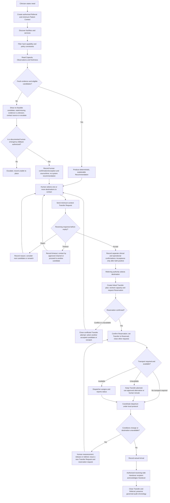
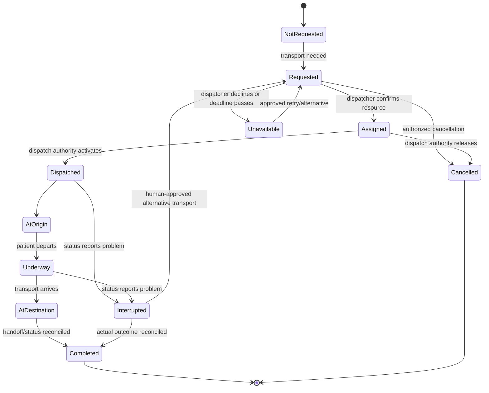

# Reference Workflow: Emergency Inter-Facility Referral and Transfer

This is a domain and safety model, not an implementation specification. Local clinical protocols, legal authority, capacity definitions, freshness windows, and escalation contacts must be set by each deployment.

## Responsibilities and invariants

- The referring clinical team assesses the patient and states the Care Requirement. AyuVahak does not triage or invent a clinical requirement.
- Matching filters and ranks from explicit, versioned rules and attributed evidence. It explains every inclusion, exclusion, unknown, and ranking input.
- A Destination Recommendation is advisory. The authorized referring clinician/operator chooses whom to contact and which destination to pursue.
- A Transfer Request asks a receiving facility to consider a specific case. Receiving clinical and operational actors retain their respective decisions.
- The receiving side records separate Clinical Suitability and Operational Readiness Assessments. The Acceptance Authority records facility Acceptance only after both are positive; Acceptance does not reserve capacity. Each deployment maps these functions to authorized people, teams, or explicitly governed processes. Job titles are not fixed by the domain; if one person performs multiple functions, the separate facts and authority for each remain explicit.
- Reservation is a separate, time-bounded commitment by the designated receiving authority. It is not admission or a physical bed assignment unless the local authoritative system explicitly says so.
- Referral, Transfer, and Transport are separate lifecycles. A transfer may be accepted before transport is assigned. AyuVahak does not dispatch vehicles.
- A direct system-to-dispatch request is optional and requires explicit deployment authorization. Otherwise, an authorized person contacts the dispatcher through the local channel and records source-attributed status.
- A current capacity observation can become false immediately. Revalidate before reservation and act on changes during the journey.
- Patient Context is purpose-limited and shared only with authorized participants. The complete clinical record remains with the clinical source.

## Happy path

1. An authorized referring clinician/operator creates a Referral with origin, source patient identifier/reference, minimum necessary Patient Context, Care Requirement, asserted urgency, and known timing constraints.
2. Directory discovery returns facilities and services with provenance. Hard eligibility rules remove candidates that lack a required capability or violate a stated operational constraint.
3. Capacity retrieves observations for eligible candidates. Each observation has a source, unit/time window, observed time, received time, and validity policy. Stale or missing evidence becomes unknown, not available.
4. Matching returns an explainable Destination Recommendation. It lists eligible candidates and any candidates withheld as unknown, plus evidence timestamps and reasons. Ranking uses a versioned deterministic policy; there is no opaque weighted score or clinical inference.
5. The responsible human reviews the result and selects one or more facilities to contact under local policy. A deployment may issue nonbinding Transfer Requests in parallel. Each request has an expiry and minimum necessary context.
6. The receiving side records a Clinical Suitability Assessment and an Operational Readiness Assessment as separate attributed facts. Both must be positive before the Acceptance Authority records facility Acceptance. Either assessment may be negative, conditional, or pending. No response by the deadline expires the request. Local policy maps these functions to roles, teams, or a governed process.
7. Acceptance is not a winner by itself. The referring authority selects one accepted destination and creates a linked Transfer planning record in Planned state. The responsible authority rechecks capacity and requests a separate Reservation; the Transfer moves to ReservationPending.
8. If reservation is confirmed, the Transfer moves to Reserved and records the reservation source, scope, and expiry; other Transfer Requests are withdrawn or closed. A reservation conflict closes that Transfer attempt and returns the Referral to destination selection or matching. A replacement destination gets a separate linked Transfer attempt.
9. The teams agree timing and handoff. If transport is needed, AyuVahak records a purpose-limited Transport request. It sends that request to dispatch only when explicitly authorized by deployment policy; otherwise an authorized person contacts dispatch out of band and records the sourced response. Transport can remain unassigned while the Transfer is planned.
10. The transferring team records departure and relevant status. Authorized actors can report deterioration, delay, transport failure, or destination change; the receiving side revalidates readiness when circumstances change.
11. On arrival, an authorized source records the actual event time and receiving facility. The locally authorized receiving-side Handover recipient acknowledges the clinical handover and relevant context.
12. The Transfer is completed after arrival and handover are reconciled. The Referral closes with an outcome. Clinical care after handover continues in the receiving clinical system.

## Activity and decision flow



## Interaction sequence

```mermaid
sequenceDiagram
  actor Referrer as Referring clinician/operator
  participant AV as AyuVahak
  participant Dir as Directory
  participant Cap as Capacity source
  participant Facility as Receiving facility
  participant Clinical as Clinical Suitability Authority
  participant Ops as Operational Readiness Authority
  participant Accept as Facility Acceptance Authority
  participant EMS as Transport dispatcher
  actor Crew as Transport crew

  Referrer->>AV: Create Referral, Care Requirement, minimum context
  AV->>Dir: Discover facilities/services
  Dir-->>AV: Candidate facts with provenance
  AV->>Cap: Retrieve capacity observations
  Cap-->>AV: Observations with source and times
  alt Capacity is stale or unknown
    AV-->>Referrer: Mark candidate unknown; request confirmation or fallback
    Referrer->>Ops: Confirm through approved channel
    Ops-->>Referrer: Attributed current response
    Referrer->>AV: Record confirmation and source
  else Evidence is fresh
    AV->>AV: Filter and rank with deterministic policy
    AV-->>Referrer: Recommendation, reasons, evidence timestamps
  end
  Referrer->>AV: Select facility/facilities to contact
  AV->>Facility: Transfer Request with minimum necessary context
  alt Both receiving assessments are positive and facility accepts
    Clinical-->>AV: Clinical Suitability Assessment
    Ops-->>AV: Operational Readiness Assessment
    Accept-->>AV: Facility Acceptance after both are positive
    AV-->>Referrer: Acceptance recorded; no reservation implied
    Referrer->>AV: Select one destination
    AV->>AV: Create linked Transfer in Planned state
    AV->>Cap: Revalidate capacity
    Cap-->>AV: Current observation
    AV->>Ops: Request separate Reservation
    alt Reservation confirmed
      Ops-->>AV: Reservation confirmation and expiry
      AV->>AV: Transfer moves from ReservationPending to Reserved
      AV->>EMS: Purpose-limited transport request, if needed
      alt Transport assigned
        EMS-->>AV: Assignment/status reference
        EMS->>Crew: Dispatch under EMS authority
        Crew-->>AV: Pickup, departure, journey and arrival facts
      else Transport unavailable
        EMS-->>AV: Unavailable
        AV-->>Referrer: Transfer remains planned; coordinate alternative
      end
      Accept-->>AV: Patient Arrival and Handover acknowledgement from authorized source
      AV-->>Referrer: Transfer completed after reconciliation
    else Reservation conflict or capacity lost
      Ops-->>AV: Conflict/unavailable
      AV-->>Referrer: Close this Transfer attempt; select another destination and create a linked attempt
    end
  else Rejected or no response
    Clinical-->>AV: Clinical rejection, when applicable
    Ops-->>AV: Operational rejection, when applicable
    AV-->>Referrer: Record outcome; contact next candidate or escalate
  end
```

The sequence shows decision functions, not mandatory job titles. A deployment maps the three receiving-side authorities to local roles, teams, or governed processes. Manual calls, late reports, and network partitions use the same attributed facts and reconciliation rules.
## State models

### Transfer Request response

```mermaid
stateDiagram-v2
  [*] --> Draft
  Draft --> Sent: authorized request issued
  Sent --> Accepted: both confirmations positive; authorized facility Acceptance recorded
  Sent --> Rejected: explicit rejection
  Sent --> Expired: response deadline passed
  Sent --> Withdrawn: referrer withdraws
  Accepted --> Selected: referring authority chooses destination
  Accepted --> Withdrawn: another destination selected
  Selected --> [*]
  Expired --> [*]
  Rejected --> [*]
  Withdrawn --> [*]
```



Clinical Suitability and Operational Readiness Assessments are stored as separate attributed facts. Acceptance is a separate facility response after both required assessments are positive. An acceptance that arrives after expiry is recorded as a late response; it requires explicit authorized reconfirmation and a new capacity check. It does not reopen or reserve automatically.

### Referral

```mermaid
stateDiagram-v2
  [*] --> Draft
  Draft --> Open: submit
  Open --> Searching: discover/match
  Searching --> AwaitingResponses: requests issued
  AwaitingResponses --> Searching: all rejected, expired, or withdrawn
  AwaitingResponses --> TransferPlanning: accepted destination selected; create Transfer
  Searching --> UnableToPlace: no eligible candidate after escalation
  AwaitingResponses --> UnableToPlace: no accepted candidate after escalation
  TransferPlanning --> Searching: reservation conflict or destination lost; close attempt
  TransferPlanning --> TransferActive: Reservation confirmed
  TransferActive --> Searching: rerouting required
  Searching --> TransferPlanning: replacement destination selected; create linked Transfer
  TransferActive --> ClosedComplete: linked Transfer handover reconciled
  Open --> Cancelled: authorized cancellation
  Searching --> Cancelled: authorized cancellation
  AwaitingResponses --> Cancelled: authorized cancellation
  TransferPlanning --> Cancelled: before movement; release any reservation
  ClosedComplete --> [*]
  UnableToPlace --> [*]
  Cancelled --> [*]
```



Referral status is a case-level summary owned by Referral. Once linked Transfers exist, Referral reflects their outcomes at a high level; Transfer remains authoritative for reservation and movement details. A Referral may have several closed or failed Transfer attempts but only one selected active reservation at a time.

### Transfer

```mermaid
stateDiagram-v2
  [*] --> Planned
  Planned --> ReservationPending
  ReservationPending --> Reserved: confirmed by responsible authority
  ReservationPending --> ReservationConflict: conflict or source unavailable
  ReservationConflict --> [*]
  ReservationPending --> Cancelled: request expires or is cancelled
  Reserved --> Ready: coordination and timing agreed
  Ready --> InTransit: actual departure reported
  Reserved --> Cancelled: cancelled before departure; release hold
  Ready --> Cancelled: cancelled before departure; release hold
  InTransit --> Arrived: patient arrival reported
  InTransit --> Redirecting: destination unavailable or route change needed
  Redirecting --> Redirected: close original leg; linked replacement Transfer starts Planned
  Redirected --> [*]
  InTransit --> Aborted: movement stopped; human records outcome
  Arrived --> HandoverPending
  HandoverPending --> Completed: locally authorized receiving care-team member acknowledges handover
  HandoverPending --> Completed: later reconciliation of handover already done
  Completed --> [*]
  Cancelled --> [*]
  Aborted --> [*]
```



A Transfer plan is created for the selected destination before Reservation; that attempt starts Planned and then enters ReservationPending. A reservation conflict or expiry closes that attempt. A replacement destination receives a new linked Transfer record, rather than changing the target of the existing record. A change of destination after departure closes the original leg as Redirected and creates a linked replacement Transfer in Planned state. Whether a particular movement can be safely redirected is a human clinical/operational decision.

### Transport



## Failure and exception handling

| Condition | AyuVahak behavior | Human/authority action and recorded outcome |
| --- | --- | --- |
| Stale or missing capacity before recommendation | Show candidate as unknown/needs confirmation; exclude it from the feasible ranked set. Do not call it available. | Contact the source or use an explicitly authorized fallback; record who confirmed and when. |
| Capacity disappears after recommendation | Invalidate the affected recommendation evidence and notify the referrer if a Transfer Request or selection depends on it. | Reassess and select another candidate; no recommendation is a promise. |
| Capacity changes after acceptance but before reservation | Require a new source confirmation; Reservation remains pending. | Operational Readiness Authority confirms, rejects, or proposes conditions; conflict returns to candidate selection. |
| Reservation conflict | Do not mark reserved; retain conflict/source details and keep exactly one selected active reservation attempt. | Choose another accepted candidate or re-run matching. |
| Receiving rejection | Record explicit rejection, actor/source, reason if shared, and time. | Contact another candidate or escalate; rejection is not a clinical outcome for the patient. |
| Timeout/no response | Mark the request expired after its configured deadline; do not infer rejection or acceptance. | Use approved telephone/radio escalation or move to another candidate. A late response requires reconfirmation. |
| Patient deterioration | Preserve previous requirement and recommendation as history; mark them no longer sufficient when care need changes. | Referring clinician reassesses, updates the Care Requirement, and chooses a new destination. Notify affected receiving facilities; re-match and re-reserve. |
| Receiving facility becomes unavailable before departure | Withdraw/expire its reservation if possible; re-open destination search. | Referring authority and the local operational-readiness authority coordinate rerouting; all external holds are explicitly released or reconciled. |
| Receiving facility becomes unavailable after departure | Do not silently redirect a vehicle or patient. Record the event and alert authorized teams. | Clinical/transport authorities decide safe destination or stabilization; record the new linked leg and handoff. |
| Transfer cancellation before departure | Cancel the Transfer, release reservation and transport request where possible, keep audit history. | Authorized clinician/coordinator records reason and informs participants. Referral may remain open if care is still needed. |
| Cancellation request after departure | Do not model as ordinary cancellation or erase movement. | Authorized clinical/transport actors decide whether to stop, divert, or continue; record as interrupted, aborted, or redirected. |
| Transport unavailable | Keep a Transfer with confirmed Reservation distinct from transport status; show transport unassigned/unavailable. | Dispatcher or coordinator uses authorized alternatives. Referrer decides whether to wait, arrange other transport, or reroute. |
| Network interruption | Mark outbound changes pending; do not claim delivery, Acceptance, Reservation, or current capacity. Preserve the last confirmed state. | Teams use approved phone/radio/local protocol for urgent action, then reconcile actual event time, actor, and source when connected. |
| Duplicate message | Recognize repeated event/command by stable external/correlation identity where possible; retain one business outcome and audit the duplicate. | If identifiers conflict, flag for human reconciliation; never create a second active reservation from a duplicate. |
| Delayed or out-of-order message | Preserve both event time and receipt time. Older state updates cannot silently regress a newer state; factual late reports remain recordable. | Reconcile contradictory facts with the responsible source; publish a correction/new event rather than deleting history. |
| Patient arrives before digital workflow catches up | Allow an authorized arrival report even when dispatch/departure events are absent; do not block care or fabricate missing steps. | Record the actual time/source, mark chronology incomplete, proceed to handover, and reconcile earlier events later. |
| Handover occurred but acknowledgement is delayed | Keep Transfer in a reconciliation state; do not imply care was not handed over or that it is complete without evidence. | The locally authorized receiving care-team member or reporter records the actual handover time and acknowledgement when available. |
| No eligible destination | Distinguish hard ineligibility from unknown/stale evidence; show the reasons. | Escalate to the responsible clinical/district authority and use local emergency pathways; record unable-to-place outcome. |
| Audit or notification channel failure | Do not report successful delivery when a channel failed. Required audit capture failure is surfaced as a system incident. | Use approved alternate contact and reconcile the case; privileged actions follow the deployment's audit-failure policy. |

## Delivery, ordering, and reconciliation guarantees

AyuVahak cannot make a remote healthcare system participate in one atomic transaction. Each cross-system action is therefore an explicit request with a pending, confirmed, rejected, expired, or failed outcome. Outbound delivery is retried with idempotent identity; duplicates are safe; delayed facts retain their chronology. External success acknowledgements are not confused with business decisions.

During network loss, local work can be noted as provisional or out-of-band, but the system must not present it as a confirmed distributed reservation or acceptance until the authorized source confirms it. Reconciliation preserves original event time, record time, actor, source, and any correction.


